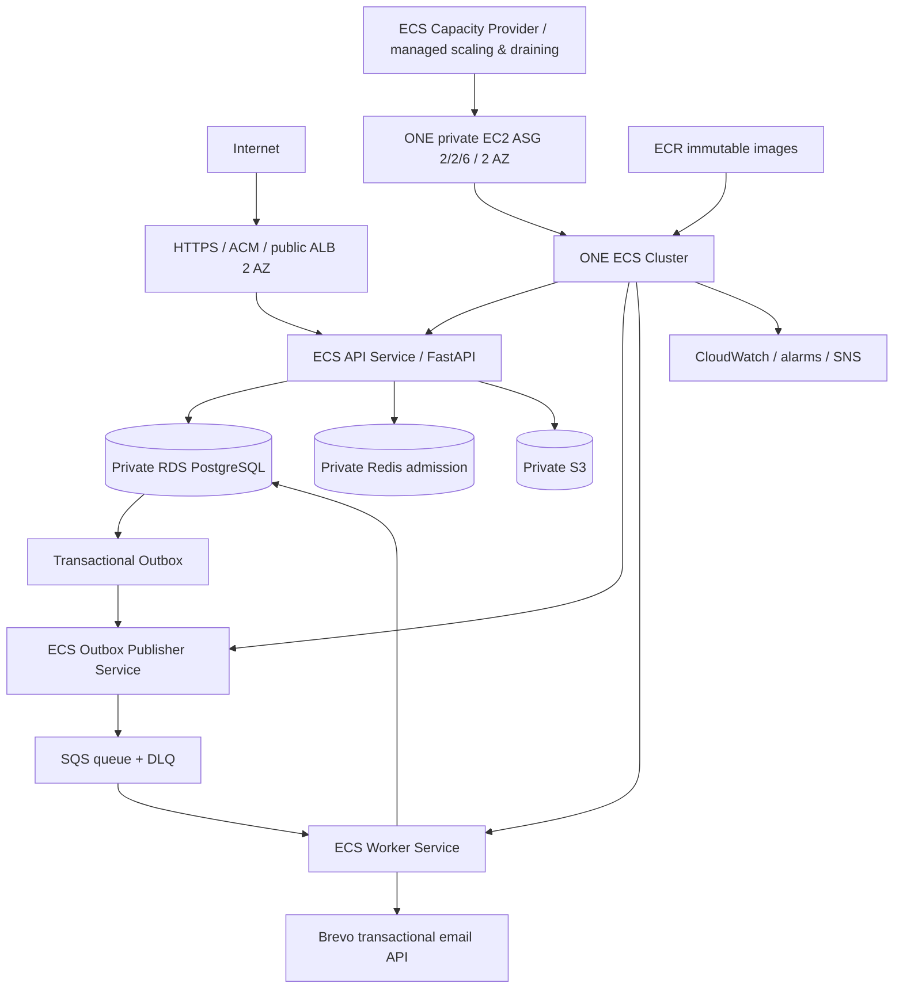

# LABSEAT 0.6.0 — ECS trên EC2

Đã implement trong repository; chưa triển khai hoặc xác minh trên AWS. Audit: [ecs-audit](../implementation/ecs-audit.md).

Một codebase, một image, một Uvicorn worker/task. API service min2/max8; CPU65%, memory65% hoặc ALB300 request/target/min là giá trị khởi đầu. Ba ECS services (API, worker, publisher); publisher desired1 nhưng an toàn khi overlap trong rolling deployment. Không tạo cluster/ASG riêng cho worker. Không GitHub Actions/OIDC/CodePipeline.

ASG dùng ECS-optimized AL2023 AMI từ public SSM parameter, instance profile chỉ ECS agent/SSM, IMDSv2 và chặn container truy cập instance metadata. Task dùng awsvpc, private ENI, TG ip; ALB kiểm `/healthz`. App/worker/publisher có task roles riêng; execution role pull ECR/log/inject SSM. AWS outbound qua NAT; S3 gateway endpoint. Network/data/IAM/cache là module tái sử dụng, không dựng VPC/RDS/S3 thứ hai.

`/healthz` không gọi dependency. `/readyz` kiểm DB; `/readyz/queue` giữ policy/epoch/marker checks. DB/Redis outage không khiến ALB đồng loạt loại process sống. Smoke release chạy one-off task cùng API task definition/image/runtime, kiểm kết nối và schema DB.

Khóa booking và PostgreSQL constraints không đổi: không oversell, một registration hiệu lực/user/session, deadline do DB quyết định, không confirm hold hết hạn. Login/session/CSRF vẫn PostgreSQL; ảnh dùng S3 hoặc local shared volume. Redis admission và Pub/Sub dùng ACL riêng; SQS chỉ background. Redis consume lỗi sau commit không mất hold/vé.

Email hiện tại: [Brevo API và mẫu LABSEAT](../deployment/brevo.md).

Outbox và delivery: [event pipeline](../deployment/events.md). Deployment: [runbook](../deployment/aws.md). Quy mô/budget: [capacity](../deployment/capacity.md). Bằng chứng local và giới hạn AWS: [evidence](../../evidence/current/README.md).

Platform security và vòng đời: [đặc tả](../dac-ta-he-thong.md), [maintenance](../deployment/maintenance.md), [restore](../deployment/recovery.md). Một connection trong budget API3 dành riêng durable rate counters; pool nghiệp vụ2, background1. Scheduler task có role maintenance riêng; Redis events không có quyền queue key. SSE chỉ invalidation; polling và snapshots DB bảo vệ correctness.
