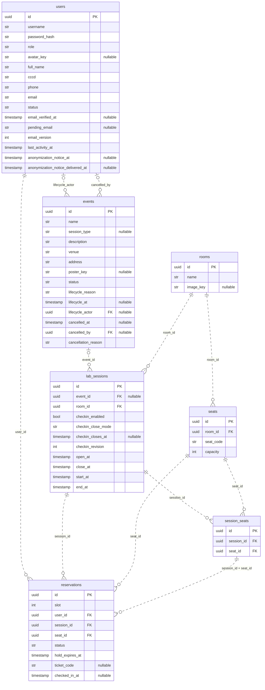
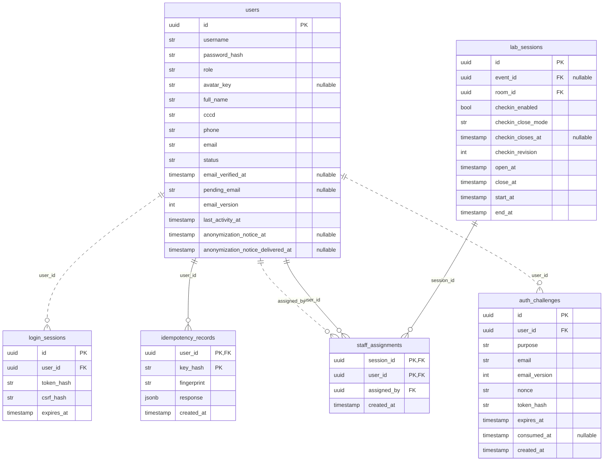
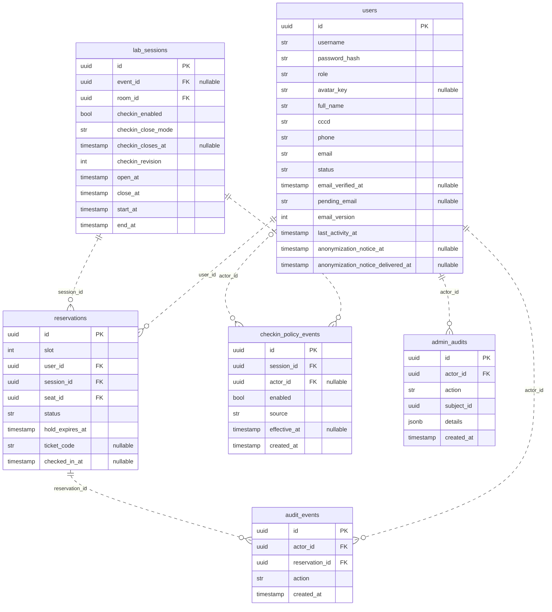
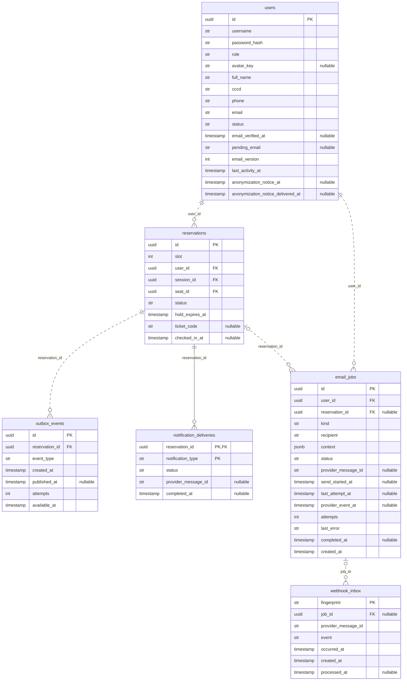
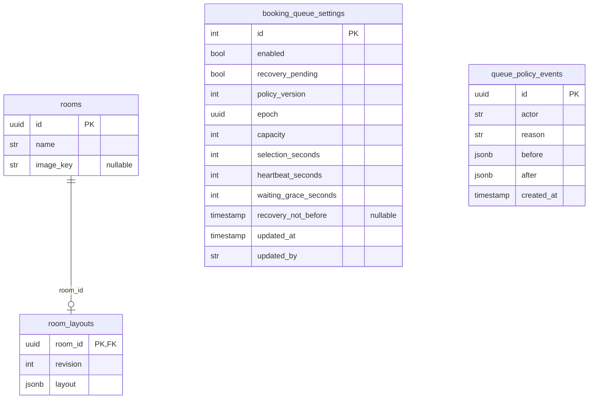
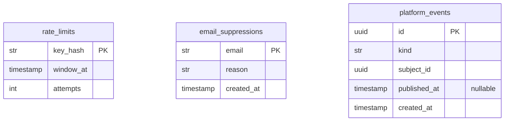
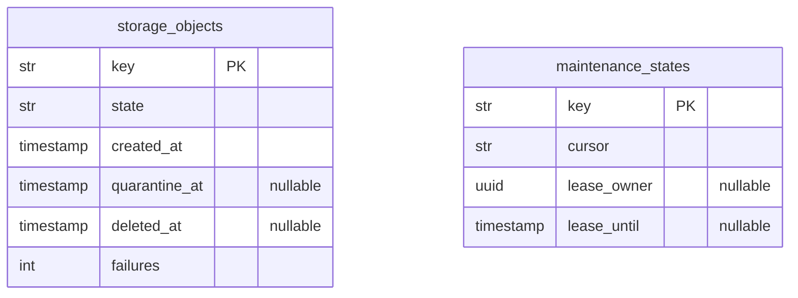

# A3 — ERD và từ điển dữ liệu


Nguồn: `app/models.py`, `migrations/versions/0001_labseat.py`, `0002_platform.py` do người dùng cung cấp. Phân tích tĩnh, chưa truy vấn schema RDS.


Tổng cộng **26 bảng**, **28 ràng buộc khóa ngoại** (khóa ngoại ghép tính một ràng buộc). Kiểm tra AST xác nhận tập bảng, tên cột và ánh xạ FK khớp giữa model và hai migration. Chưa so sánh tự động toàn bộ kiểu, default, index và CHECK.


## Cách đọc
PK = khóa chính; FK = khóa ngoại. Cạnh nét liền dùng khi FK nằm trong PK của bảng con; nét đứt cho quan hệ còn lại. `o|` ở phía cha là FK nullable. Mỗi bảng cha có thể chưa có bản ghi con. Một số bảng được lặp ở các hình để đọc độc lập.


## 01-booking



## 02-auth-staff



## 03-audit



## 04-notifications



## 05-support



## 06-platform



## 07-maintenance



## Ràng buộc cần giải thích khi bảo vệ

- Một user có tối đa một reservation ACTIVE trong một session: unique index có điều kiện trên `(user_id, session_id)`.
- Một slot có tối đa một reservation ACTIVE: `(seat_id, session_id, slot)`. ACTIVE = HELD/CONFIRMED/CHECKED_IN.
- `capacity` nằm trong [1, 100000]; `slot >= 0`. DB không khai báo CHECK liên bảng `slot < capacity`; service chọn slot trong `range(capacity)`.
- `(session_id, seat_id)` của reservation phải tồn tại trong session_seats. Không dùng `session_seats.id` để nối FK này.
- Vé CONFIRMED/CHECKED_IN phải có ticket_code; trạng thái CHECKED_IN tương đương checked_in_at khác NULL.
- Thời gian ca: open_at < close_at <= start_at < end_at. HELD không tự hết hạn chỉ vì thời gian trôi qua; cần logic ứng dụng/dọn dữ liệu.
- Model không khai báo FK từ avatar_key/image_key/poster_key tới storage_objects.key. Không vẽ các khóa này như FK.
- admin_audits.subject_id, platform_events.subject_id, maintenance_states.lease_owner không có FK trong model.
- Một Room có tối đa một RoomLayout vì room_id vừa PK vừa FK.
- booking_queue_settings có CHECK id=1; bảng policy/audit dạng actor chuỗi không tự tạo quan hệ tới users.
- Email normalized và CCCD chỉ unique khi giá trị không rỗng; username unique.
- Ràng buộc một đăng ký theo event có kiểm tra trong service, không phải unique index theo event ở DB.


## Từ điển dữ liệu và constraint đầy đủ

### users

Nguồn: `app/models.py:10`.

| Cột | Kiểu Python/logic | Nullable | Khóa |
|---|---|---|---|

| id | uuid | Không | PK |

| username | str | Không | — |

| password_hash | str | Không | — |

| role | str | Không | — |

| avatar_key | str | Có | — |

| full_name | str | Không | — |

| cccd | str | Không | — |

| phone | str | Không | — |

| email | str | Không | — |

| status | str | Không | — |

| email_verified_at | timestamp | Có | — |

| pending_email | str | Có | — |

| email_version | int | Không | — |

| last_activity_at | timestamp | Không | — |

| anonymization_notice_at | timestamp | Có | — |

| anonymization_notice_delivered_at | timestamp | Có | — |

```python

CheckConstraint("role IN ('student','staff','admin')", name='users_role_check')
CheckConstraint("status IN ('ACTIVE','LOCKED','ANONYMIZED')", name='users_status_check')
Index('uq_users_email', func.lower(func.btrim(email)), unique=True, postgresql_where=text("email <> ''"))
Index('uq_users_cccd', 'cccd', unique=True, postgresql_where=text("cccd <> ''"))

```

### login_sessions

Nguồn: `app/models.py:34`.

| Cột | Kiểu Python/logic | Nullable | Khóa |
|---|---|---|---|

| id | uuid | Không | PK |

| user_id | uuid | Không | FK → users.id |

| token_hash | str | Không | — |

| csrf_hash | str | Không | — |

| expires_at | timestamp | Không | — |

### rooms

Nguồn: `app/models.py:41`.

| Cột | Kiểu Python/logic | Nullable | Khóa |
|---|---|---|---|

| id | uuid | Không | PK |

| name | str | Không | — |

| image_key | str | Có | — |

### seats

Nguồn: `app/models.py:46`.

| Cột | Kiểu Python/logic | Nullable | Khóa |
|---|---|---|---|

| id | uuid | Không | PK |

| room_id | uuid | Không | FK → rooms.id |

| seat_code | str | Không | — |

| capacity | int | Không | — |

```python

UniqueConstraint('room_id', 'seat_code')
CheckConstraint('capacity >= 1 AND capacity <= 100000', name='seat_capacity_range')

```

### events

Nguồn: `app/models.py:53`.

| Cột | Kiểu Python/logic | Nullable | Khóa |
|---|---|---|---|

| id | uuid | Không | PK |

| name | str | Không | — |

| session_type | str | Có | — |

| description | str | Không | — |

| venue | str | Không | — |

| address | str | Không | — |

| poster_key | str | Có | — |

| status | str | Không | — |

| lifecycle_reason | str | Không | — |

| lifecycle_at | timestamp | Có | — |

| lifecycle_actor | uuid | Có | FK → users.id |

| cancelled_at | timestamp | Có | — |

| cancelled_by | uuid | Có | FK → users.id |

| cancellation_reason | str | Không | — |

```python

CheckConstraint("session_type IS NULL OR session_type IN ('exam','practice')", name='session_type_values')

```

### lab_sessions

Nguồn: `app/models.py:70`.

| Cột | Kiểu Python/logic | Nullable | Khóa |
|---|---|---|---|

| id | uuid | Không | PK |

| event_id | uuid | Có | FK → events.id |

| room_id | uuid | Không | FK → rooms.id |

| checkin_enabled | bool | Không | — |

| checkin_close_mode | str | Không | — |

| checkin_closes_at | timestamp | Có | — |

| checkin_revision | int | Không | — |

| open_at | timestamp | Không | — |

| close_at | timestamp | Không | — |

| start_at | timestamp | Không | — |

| end_at | timestamp | Không | — |

```python

CheckConstraint('open_at < close_at AND close_at <= start_at AND start_at < end_at')

```

### session_seats

Nguồn: `app/models.py:84`.

| Cột | Kiểu Python/logic | Nullable | Khóa |
|---|---|---|---|

| id | uuid | Không | PK |

| session_id | uuid | Không | FK → lab_sessions.id |

| seat_id | uuid | Không | FK → seats.id |

```python

UniqueConstraint('session_id', 'seat_id')

```

### reservations

Nguồn: `app/models.py:90`.

| Cột | Kiểu Python/logic | Nullable | Khóa |
|---|---|---|---|

| id | uuid | Không | PK |

| slot | int | Không | — |

| user_id | uuid | Không | FK → users.id |

| session_id | uuid | Không | FK → lab_sessions.id |

| seat_id | uuid | Không | FK → seats.id |

| status | str | Không | — |

| hold_expires_at | timestamp | Không | — |

| ticket_code | str | Có | — |

| checked_in_at | timestamp | Có | — |

```python

ForeignKeyConstraint(['session_id', 'seat_id'], ['session_seats.session_id', 'session_seats.seat_id'])
CheckConstraint("status IN ('HELD','CONFIRMED','CHECKED_IN','EXPIRED','CANCELLED')")
CheckConstraint("status NOT IN ('CONFIRMED','CHECKED_IN') OR ticket_code IS NOT NULL")
CheckConstraint("(status = 'CHECKED_IN') = (checked_in_at IS NOT NULL)")
Index('uq_active_user_session', 'user_id', 'session_id', unique=True, postgresql_where=text("status IN ('HELD','CONFIRMED','CHECKED_IN')"))
CheckConstraint('slot >= 0', name='reservation_slot_nonnegative')
Index('uq_active_seat_session', 'seat_id', 'session_id', 'slot', unique=True, postgresql_where=text("status IN ('HELD','CONFIRMED','CHECKED_IN')"))

```

### audit_events

Nguồn: `app/models.py:110`.

| Cột | Kiểu Python/logic | Nullable | Khóa |
|---|---|---|---|

| id | uuid | Không | PK |

| actor_id | uuid | Không | FK → users.id |

| reservation_id | uuid | Không | FK → reservations.id |

| action | str | Không | — |

| created_at | timestamp | Không | — |

### room_layouts

Nguồn: `app/models.py:118`.

| Cột | Kiểu Python/logic | Nullable | Khóa |
|---|---|---|---|

| room_id | uuid | Không | PK, FK → rooms.id |

| revision | int | Không | — |

| layout | jsonb | Không | — |

### booking_queue_settings

Nguồn: `app/models.py:125`.

| Cột | Kiểu Python/logic | Nullable | Khóa |
|---|---|---|---|

| id | int | Không | PK |

| enabled | bool | Không | — |

| recovery_pending | bool | Không | — |

| policy_version | int | Không | — |

| epoch | uuid | Không | — |

| capacity | int | Không | — |

| selection_seconds | int | Không | — |

| heartbeat_seconds | int | Không | — |

| waiting_grace_seconds | int | Không | — |

| recovery_not_before | timestamp | Có | — |

| updated_at | timestamp | Không | — |

| updated_by | str | Không | — |

```python

CheckConstraint('id = 1', name='queue_singleton')
CheckConstraint('capacity BETWEEN 1 AND 100', name='queue_capacity_range')
CheckConstraint('selection_seconds BETWEEN 1 AND 600', name='queue_selection_range')
CheckConstraint('heartbeat_seconds BETWEEN 1 AND 30', name='queue_heartbeat_range')
CheckConstraint('waiting_grace_seconds > heartbeat_seconds AND waiting_grace_seconds <= 600', name='queue_grace_range')

```

### queue_policy_events

Nguồn: `app/models.py:148`.

| Cột | Kiểu Python/logic | Nullable | Khóa |
|---|---|---|---|

| id | uuid | Không | PK |

| actor | str | Không | — |

| reason | str | Không | — |

| before | jsonb | Không | — |

| after | jsonb | Không | — |

| created_at | timestamp | Không | — |

### idempotency_records

Nguồn: `app/models.py:157`.

| Cột | Kiểu Python/logic | Nullable | Khóa |
|---|---|---|---|

| user_id | uuid | Không | PK, FK → users.id |

| key_hash | str | Không | PK |

| fingerprint | str | Không | — |

| response | jsonb | Không | — |

| created_at | timestamp | Không | — |

### outbox_events

Nguồn: `app/models.py:167`.

| Cột | Kiểu Python/logic | Nullable | Khóa |
|---|---|---|---|

| id | uuid | Không | PK |

| reservation_id | uuid | Không | FK → reservations.id |

| event_type | str | Không | — |

| created_at | timestamp | Không | — |

| published_at | timestamp | Có | — |

| attempts | int | Không | — |

| available_at | timestamp | Không | — |

```python

UniqueConstraint('reservation_id', 'event_type', name='uq_outbox_reservation_event')
Index('ix_outbox_pending', 'available_at', postgresql_where=text('published_at IS NULL'))

```

### notification_deliveries

Nguồn: `app/models.py:181`.

| Cột | Kiểu Python/logic | Nullable | Khóa |
|---|---|---|---|

| reservation_id | uuid | Không | PK, FK → reservations.id |

| notification_type | str | Không | PK |

| status | str | Không | — |

| provider_message_id | str | Có | — |

| completed_at | timestamp | Có | — |

```python

CheckConstraint("status IN ('PENDING','SENT','SKIPPED')", name='notification_status')

```

### checkin_policy_events

Nguồn: `app/models.py:191`.

| Cột | Kiểu Python/logic | Nullable | Khóa |
|---|---|---|---|

| id | uuid | Không | PK |

| session_id | uuid | Không | FK → lab_sessions.id |

| actor_id | uuid | Có | FK → users.id |

| enabled | bool | Không | — |

| source | str | Không | — |

| effective_at | timestamp | Có | — |

| created_at | timestamp | Không | — |

### staff_assignments

Nguồn: `app/models.py:201`.

| Cột | Kiểu Python/logic | Nullable | Khóa |
|---|---|---|---|

| session_id | uuid | Không | PK, FK → lab_sessions.id |

| user_id | uuid | Không | PK, FK → users.id |

| assigned_by | uuid | Không | FK → users.id |

| created_at | timestamp | Không | — |

### admin_audits

Nguồn: `app/models.py:209`.

| Cột | Kiểu Python/logic | Nullable | Khóa |
|---|---|---|---|

| id | uuid | Không | PK |

| actor_id | uuid | Không | FK → users.id |

| action | str | Không | — |

| subject_id | uuid | Không | — |

| details | jsonb | Không | — |

| created_at | timestamp | Không | — |

### auth_challenges

Nguồn: `app/models.py:218`.

| Cột | Kiểu Python/logic | Nullable | Khóa |
|---|---|---|---|

| id | uuid | Không | PK |

| user_id | uuid | Không | FK → users.id |

| purpose | str | Không | — |

| email | str | Không | — |

| email_version | int | Không | — |

| nonce | str | Không | — |

| token_hash | str | Không | — |

| expires_at | timestamp | Không | — |

| consumed_at | timestamp | Có | — |

| created_at | timestamp | Không | — |

### rate_limits

Nguồn: `app/models.py:231`.

| Cột | Kiểu Python/logic | Nullable | Khóa |
|---|---|---|---|

| key_hash | str | Không | PK |

| window_at | timestamp | Không | — |

| attempts | int | Không | — |

### email_jobs

Nguồn: `app/models.py:238`.

| Cột | Kiểu Python/logic | Nullable | Khóa |
|---|---|---|---|

| id | uuid | Không | PK |

| user_id | uuid | Không | FK → users.id |

| reservation_id | uuid | Có | FK → reservations.id |

| kind | str | Không | — |

| recipient | str | Không | — |

| context | jsonb | Không | — |

| status | str | Không | — |

| provider_message_id | str | Có | — |

| send_started_at | timestamp | Có | — |

| last_attempt_at | timestamp | Có | — |

| provider_event_at | timestamp | Có | — |

| attempts | int | Không | — |

| last_error | str | Không | — |

| completed_at | timestamp | Có | — |

| created_at | timestamp | Không | — |

### platform_events

Nguồn: `app/models.py:256`.

| Cột | Kiểu Python/logic | Nullable | Khóa |
|---|---|---|---|

| id | uuid | Không | PK |

| kind | str | Không | — |

| subject_id | uuid | Không | — |

| published_at | timestamp | Có | — |

| created_at | timestamp | Không | — |

### webhook_inbox

Nguồn: `app/models.py:264`.

| Cột | Kiểu Python/logic | Nullable | Khóa |
|---|---|---|---|

| fingerprint | str | Không | PK |

| job_id | uuid | Có | FK → email_jobs.id |

| provider_message_id | str | Không | — |

| event | str | Không | — |

| occurred_at | timestamp | Không | — |

| created_at | timestamp | Không | — |

| processed_at | timestamp | Có | — |

### email_suppressions

Nguồn: `app/models.py:275`.

| Cột | Kiểu Python/logic | Nullable | Khóa |
|---|---|---|---|

| email | str | Không | PK |

| reason | str | Không | — |

| created_at | timestamp | Không | — |

### storage_objects

Nguồn: `app/models.py:282`.

| Cột | Kiểu Python/logic | Nullable | Khóa |
|---|---|---|---|

| key | str | Không | PK |

| state | str | Không | — |

| created_at | timestamp | Không | — |

| quarantine_at | timestamp | Có | — |

| deleted_at | timestamp | Có | — |

| failures | int | Không | — |

### maintenance_states

Nguồn: `app/models.py:292`.

| Cột | Kiểu Python/logic | Nullable | Khóa |
|---|---|---|---|

| key | str | Không | PK |

| cursor | str | Không | — |

| lease_owner | uuid | Có | — |

| lease_until | timestamp | Có | — |
