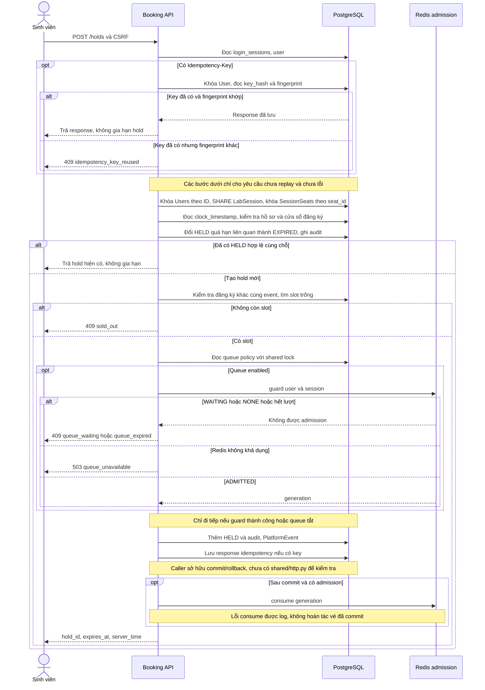
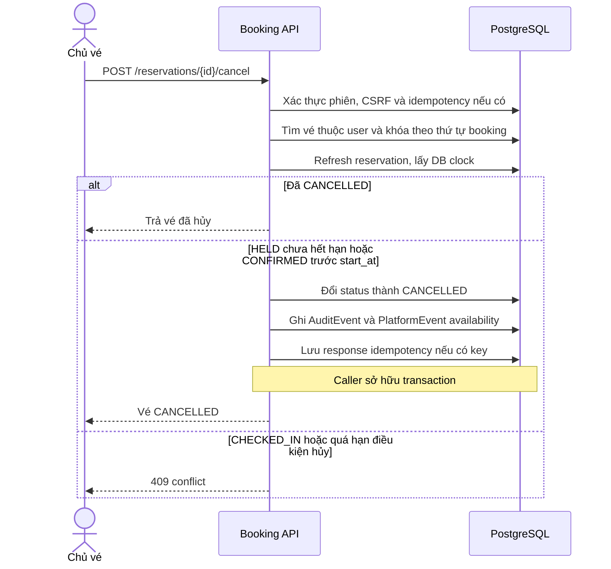
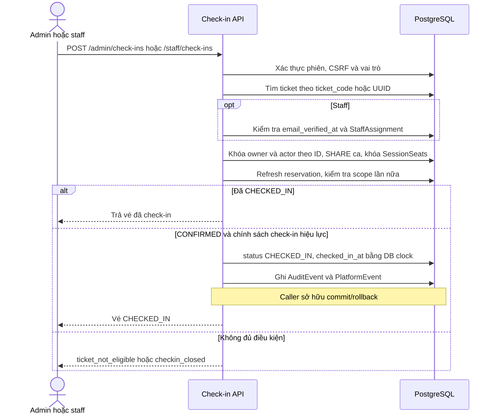
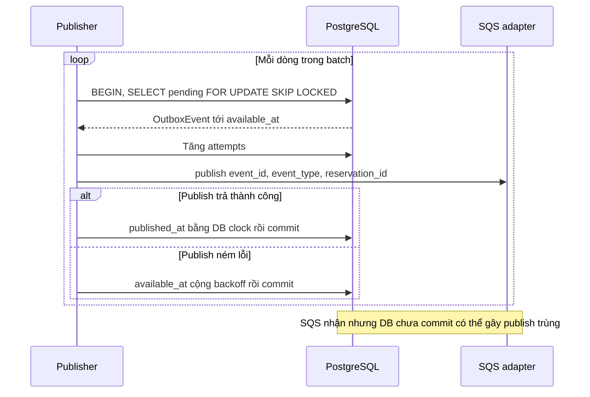
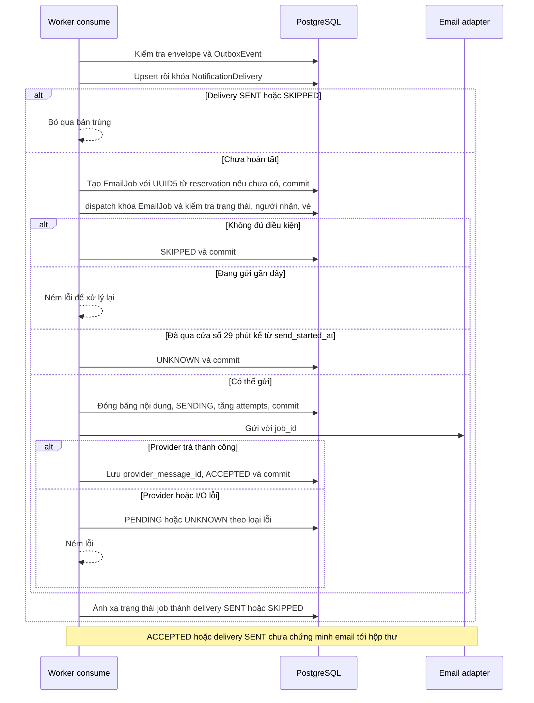

# A3 — Sequence theo source

Các endpoint ghi theo decorator trong file đã cung cấp; chưa xác minh prefix include_router tại app/main.py. Nhánh lỗi kết thúc yêu cầu; các bước tiếp theo chỉ áp dụng khi không lỗi. Các sơ đồ là phân tích source, không phải trace chạy thật.

## Giữ chỗ và admission



Nguồn và giới hạn: app/modules/booking/router.py:hold; service.py:hold; repository.py:lock; idempotency.py:execute; app/infrastructure/redis/admission.py:guard,release_after_commit.

Hold hết hạn tại min(DB clock + 180 giây, close_at). Giữ chỗ hiện có được trả lại trước guard; Redis không là kho lưu vé. Hàm require_for_exam nằm ngoài ZIP nên điều kiện hồ sơ chi tiết chưa được review.

## Xác nhận vé và outbox

```mermaid
sequenceDiagram
    actor U as Sinh viên
    participant A as Booking API
    participant P as PostgreSQL
    U->>A: POST /holds/{hold_id}/confirm
    A->>P: Xác thực phiên, CSRF và idempotency nếu có
    A->>P: Tìm reservation thuộc user
    A->>P: Khóa Users, LabSession, SessionSeats rồi refresh reservation
    alt Đã CONFIRMED hoặc CHECKED_IN
        A-->>U: Trả vé hiện có
    else HELD còn hạn và chưa close_at
        A->>P: Kiểm tra hồ sơ, đổi thành CONFIRMED và tạo ticket_code
        A->>P: Thêm OutboxEvent ReservationConfirmed
        A->>P: Thêm AuditEvent và PlatformEvent availability
        A->>P: Lưu response idempotency nếu có key
        Note over A,P: Các ghi dùng cùng session; commit do caller quản lý
        A-->>U: Vé xác nhận
    else Trạng thái hoặc thời gian không hợp lệ
        A-->>U: 409 conflict
    end
```

Nguồn và giới hạn: app/modules/booking/router.py:confirm; service.py:transition,audit; idempotency.py:execute.

Không gửi email trực tiếp trong transition. Việc hoàn tất giao dịch HTTP cần kiểm tra thêm app/shared/http.py; sequence không coi response thành công là bằng chứng test thực tế.

## Hủy đặt chỗ



Nguồn và giới hạn: app/modules/booking/service.py:transition; router.py:cancel.

Luồng người dùng hủy ở đây không thêm OutboxEvent gửi email hủy. Không gộp với admin lifecycle cancellation vì module admin/lifecycle.py không có trong ZIP.

## Check-in theo quyền admin hoặc staff



Nguồn và giới hạn: app/modules/checkin/router.py:check_in; staff.py:checkin,scoped; policy.py:scope,effective; app/modules/booking/service.py:transition.

Chính sách hiệu lực: checkin_enabled, chưa tới deadline nếu có, event ACTIVE nếu có. Deadline theo end_at/custom/manual. Không tự suy có điều kiện clock >= start_at. Lookup chỉ xem vé, không thực hiện check-in. Staff phải được phân công đúng ca, tài khoản ACTIVE và email đã xác minh.

## Publisher chuyển outbox sang hàng đợi



Nguồn và giới hạn: app/modules/notifications/service.py:publish_batch; adapters.py:SQS.publish.

Backoff min(300, 2 ** min(attempts, 8)) giây theo biểu thức source (thực tế lũy thừa bị chặn ở 256). Đây là cơ chế at-least-once có thể trùng; không phải atomic transaction giữa PostgreSQL và SQS. Chưa đọc entrypoint worker/ack nên không khẳng định thứ tự delete message.

## Worker xử lý email xác nhận



Nguồn và giới hạn: app/modules/notifications/service.py:consume; jobs.py:enqueue,dispatch; adapters.py:email_adapter.

Bước cập nhật delivery cuối chỉ chạy khi dispatch trả về bình thường. Nhánh email_job envelope đi thẳng vào dispatch. Code có adapter Brevo, mock (local/test), disabled; chưa biết EMAIL_BACKEND runtime. Webhook được xử lý riêng trong jobs.py; chưa kiểm thử gửi hoặc nhận webhook thực tế.
