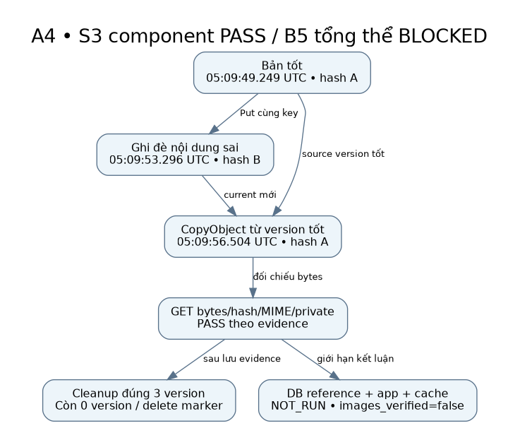
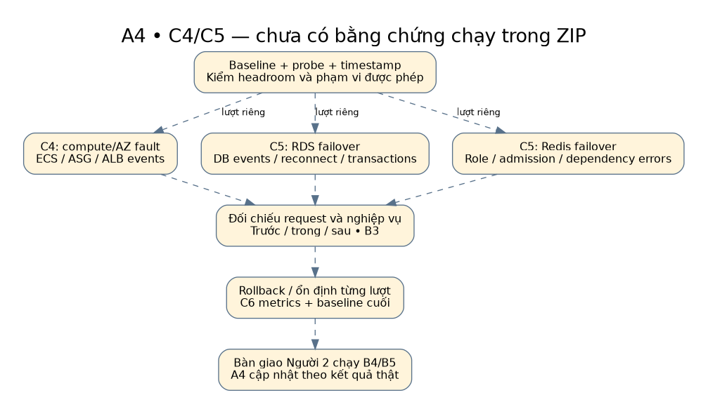

# A4 — Sự cố, khôi phục và đối chiếu bằng chứng

**Người 1 • Cập nhật 21/11/2026 • Tài liệu đã cập nhật; chưa nghiệm thu fault/restore toàn bộ.**

| Phần | Kết quả mới nhất trong gói | Giới hạn |
|---|---|---|
| B3 | Đếm trực tiếp CSV: **333 PASS, 0 FAIL, 1 BLOCKED, 3 NOT_RUN**, tổng 337 | V01 chờ video; X01/X02/X03 chưa chạy sau tải/fault/restore |
| B4 | Preflight/công cụ đã có; PITR và app restored chưa chạy | BLOCKED; RPO/RTO null |
| B5 | S3 component PASS | DB reference/app/cache NOT_RUN; images_verified=false |
| C2 | Test local PASS, có quan sát worker disabled | AWS smoke/job SKIPPED/Brevo/restore chưa đủ; C2 BLOCKED |
| C3 | Có readiness và collector chỉ đọc | 5 bài AWS tải/scaling/recovery NOT_RUN |
| C4 | Preflight hai AZ; kiểm lại capacity | Thiếu API overlap, clock/gate chưa đạt; inject/observe/rollback NOT_RUN |
| C5 | Readiness RDS/Redis có | Hai bài failover NOT_RUN |
| C6 | Có báo cáo/ma trận và snapshot chỉ đọc | Bàn giao có giới hạn; chưa xác minh baseline hậu thử nghiệm; số B3 trong C6 đã cũ |

## Tài liệu

- [Đối chiếu nguồn và sai khác](evidence-review.md)
- [Timeline và giới hạn clock](timeline.md)
- [Đánh giá RPO/RTO](recovery-assessment.md)
- [Bàn giao còn lại](handoff.md)
- [Kiểm tra gói](validation.md), [manifest nguồn](source-manifest.json), [đếm CSV B3](b3-csv-verification.json)

## Bốn sơ đồ có PNG/SVG và source DOT

### Snapshot C6 ngày 21/11 — không phải baseline sau fault

### S3 component đã được kiểm chứng trong evidence

### PITR — kế hoạch chưa thực thi

### C4/C5 — kế hoạch và các bước chưa chạy

