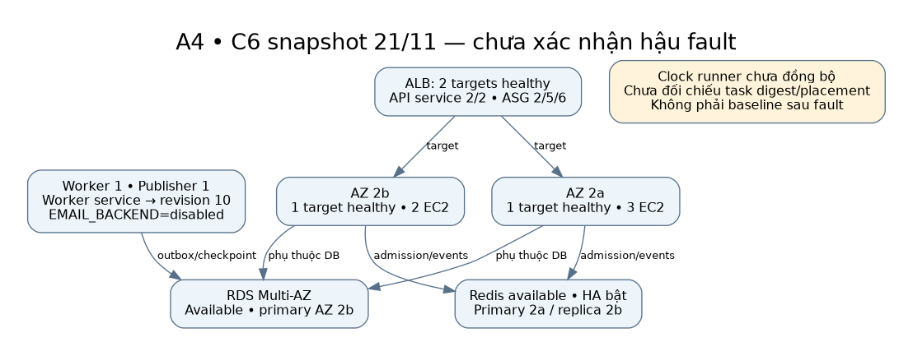
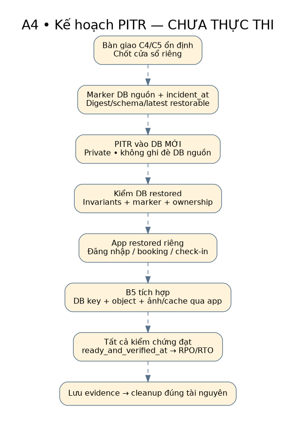

# A4 — Sự cố, khôi phục và đối chiếu bằng chứng

**Chủ sở hữu: Người 1. Ngày tổng hợp: 20/11/2026. Trạng thái: tài liệu đã lập; nghiệm thu A4 còn chờ bằng chứng.**

| Hạng mục | Bằng chứng đã có | Kết luận A4 |
|---|---|---|
| B3 kiểm nghiệp vụ | Báo cáo 329 PASS, 3 FAIL, 3 NOT_RUN, 2 BLOCKED; trộn nhiều môi trường có phân biệt | Chưa hoàn tất; X01–X03 chưa kiểm sau tải/fault/restore |
| B4 RDS PITR | Preflight AWS/SQL và công cụ local | BLOCKED; chưa restore DB/app, RPO/RTO null |
| B5 S3 | Ghi đè và CopyObject version tốt; bytes/hash/private/cleanup | S3 component PASS; B5 tổng thể BLOCKED, images_verified=false |
| C1 | 20 ảnh Console; sau đó Người 2 dùng đúng source C1 chạy smoke 4 mẫu | Có baseline thật; C1 toàn bộ chưa Accepted |
| C4 compute/AZ | Không có run fault trong hai ZIP | Chưa có bằng chứng để kết luận |
| C5 RDS/Redis failover | Có cấu hình HA, không có events/probes diễn tập | Chưa có bằng chứng để kết luận |
| C6 tổng hợp/khôi phục baseline | Có smoke trước diễn tập, chưa có đối chiếu sau fault | Chưa đủ bằng chứng đóng A4 |

## Đọc bộ A4

- [Báo cáo bằng chứng](evidence-review.md): nguồn, mức độ xác minh và điểm còn thiếu.
- [Timeline](timeline.md): mốc UTC và giờ Việt Nam; không ghép các lượt khác nhau thành một sự cố.
- [Đánh giá RPO/RTO](recovery-assessment.md): số đo được phép kết luận.
- [Bàn giao phần còn thiếu](handoff.md): việc của Người 2/3 để chốt A4.
- [Kiểm tra gói](validation.md) và [danh sách nguồn](source-manifest.json).

## Sơ đồ đã xuất ảnh

Các sơ đồ dưới có PNG, SVG và source DOT trong diagrams. Nét đứt/màu vàng là quy trình cần kiểm chứng; không biểu thị failover đã thành công.

### 1. Baseline trước diễn tập — snapshot 19/11 UTC



### 2. Khôi phục S3 — phần đã có bằng chứng


### 3. PITR và kiểm chứng ứng dụng — chưa chạy



### 4. Compute/AZ và failover dependency — chưa có run


## Đưa vào repository

```powershell
git status --short -- docs/assessment/architecture/a4
git diff --stat -- app migrations
Get-ChildItem .\docs\assessment\architecture\a4\diagrams\rendered\*.png
endered\*.png
```

Sau khi xem nội dung, có thể commit riêng thư mục A4 trên nhánh Người 1. Bộ tài liệu không tự tạo commit, push hoặc chạy AWS.
