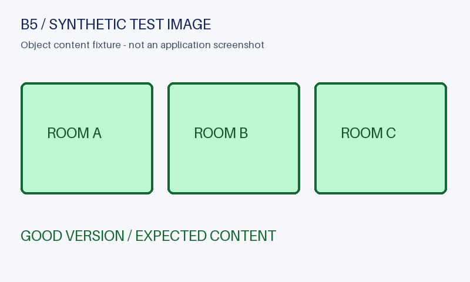
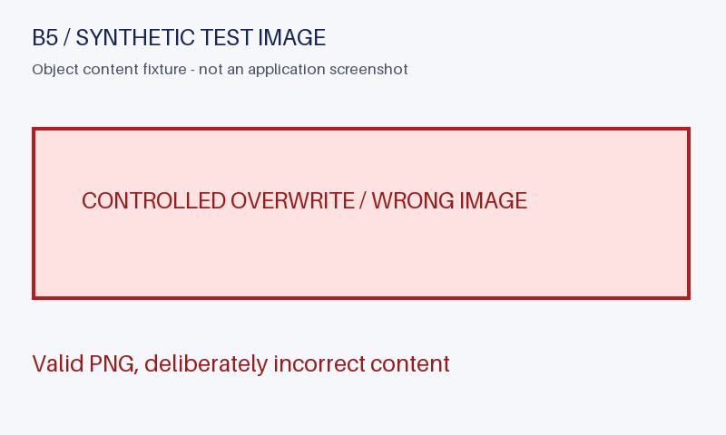

# Đối chiếu bằng chứng A4

## Snapshot nguồn

| Gói | Nhánh | Commit từ ZIP archive comment |
|---|---|---|
| A4-functional-recovery.zip | assessment/functional-recovery | `05ea11cf3008a42b33e766841320896f4a10eaba` |
| A4-load-resilience.zip | assessment/load-resilience | `7fa878ac7e7995c25777680e44fe2da36d1e619c` |

Commit snapshot ZIP khác commit ghi tại thời điểm từng run. Giữ nguyên cả hai loại trong source-manifest.json và manifest gốc. Không gán commit ZIP cho image runtime: baseline ghi API digest `sha256:8cf4b144a8c1260b22ad4a6be6277d5d3b66552cdeda407dab894258243256ee`, schema `0002_platform`.

## B4 và baseline mới nhất

Nguồn [B4 preflight](evidence/20261119T043844Z-b4-preflight/checks/results.json) và [C1 smoke do Người 2 chạy](evidence/20261119T172832Z-b4-c1-preflight/checks/results.json).

- RDS Available/Multi-AZ, retention thực **1 ngày**; LatestRestorableTime `2026-11-19T17:23:02+00:00`. Không thay bằng mặc định Terraform 30 ngày.
- 2 API RUNNING, cùng digest, trên AZ 2a/2b; worker/publisher 1 task mỗi service; 2 ALB healthy targets. ASG desired/InService 4, min 2/max 6; placement EC2: 1 máy 2a, 3 máy 2b.
- SQL lúc 17:29:35 UTC: max_connections=79, reserve=3+2, non-reserved=74. Budget 66 còn 8; rolling ceiling 65. 9 kết nối SQL gồm probe; CloudWatch 8 là nguồn/thời điểm khác, không phải mâu thuẫn.
- 7 invariant trả 0 dòng trên **DB nguồn**. Không chuyển thành database_invariants_passed của DB restored.
- Quota snapshot: DB 1/40, storage 20/100000 GiB, manual snapshots 0/100. Bổ sung này cập nhật điểm quota chưa rõ trong ảnh Console cũ; không tự chứng minh quyền/KMS hay restore thành công.
- Slot ước tính tối đa: AZ2a=1, AZ2b=3, dựa CPU/RAM/ENI; là cận trên, chưa chứng minh đặt task hay chịu mất AZ. Không suy ASG còn máy là đủ headroom.

[CSV](evidence/20261119T172832Z-b4-c1-preflight/metrics.csv): 4 mẫu, 252 dòng; OBSERVED 211, MISSING 8, MISSING_OR_DELAYED 32, OVER_INTERVAL 1. Một vòng 30,78s vượt chu kỳ yêu cầu 30s. ALB RPS 0 trong mẫu; không có tải, latency/SLO hoặc traffic phân phối được kiểm chứng. Giữ nguyên status/source_at, không điền số 0 cho dữ liệu thiếu.

Ảnh Console C1 cũ và báo cáo C1 ghi BLOCKED trước smoke bổ sung. Smoke mới là bằng chứng thật được bổ sung từ nhánh Người 2, nhưng không tự đổi nghiệm thu C1 toàn bộ thành PASS.

## B5 — phần đã chạy

Nguồn [kết quả](evidence/20261119T050938Z-b5-s3-restore/checks/results.json) và [cleanup](evidence/20261119T050938Z-b5-s3-restore/cleanup-manifest.json). Một key synthetic chưa tồn tại: Put tốt → Put nội dung sai → CopyObject từ version tốt tạo current mới. Không dùng xóa làm thao tác phục hồi.

Hash before/restored bằng nhau; overwritten khác. Ba file PNG đính kèm khớp hash khai báo. Anonymous GET=403, authenticated GET và MIME image/png đạt theo JSON; đây là bằng chứng do nhóm bàn giao, không phải lượt gọi AWS mới của Người 1.

Ảnh trên là **bytes object tải từ S3**, không phải ảnh chụp app. Cleanup báo xóa đúng 3 versions, còn 0 versions/0 delete markers; kiểm lại 05:15:03 UTC vẫn trống. Các version đã dọn không thể dùng lại cho lượt tích hợp.

## Khoảng trống

Theo đối chiếu Người 2 ngày 20/11/2026 do người dùng cung cấp, CSV chuẩn B3 ở `docs/assessment/functional/test-cases.csv` có **337 dòng: 329 PASS, 3 FAIL, 2 BLOCKED, 3 NOT_RUN**. Tổng các nhóm bằng 337. [Mở CSV trên nhánh functional-recovery](https://github.com/tuanngthuet/CloudCompuAssignment/blob/assessment/functional-recovery/docs/assessment/functional/test-cases.csv). Đây là link theo nhánh, có thể thay đổi; chưa kiểm truy cập hoặc đọc trực tiếp CSV trong lượt cập nhật này.

**Chỉ thiếu CSV trong snapshot ZIP trước**, không kết luận repository thiếu CSV. Dùng CSV chuẩn của B3 để đối chiếu, không tạo CSV thứ hai trong A4. Các số đếm mới được ghi nhận từ nội dung bàn giao, chưa tái đếm trực tiếp từng dòng CSV. X01 (sau tải), X02 (sau fault), X03 (sau restore) vẫn NOT_RUN; video vẫn chờ người dùng. PASS local và AWS được phân biệt trong B3; không dùng tổng PASS để chứng minh phục hồi.

Trong hai ZIP đã nhận, không có run C4/C5, incident/events, probe trong/sau fault hoặc phục hồi baseline C6. HA được bật và snapshot Available chỉ là cấu hình/trạng thái. Không đủ dữ liệu đo downtime, RPO/RTO hoặc availability 30 ngày.

Nguồn đọc thêm tại commit cố định: [B3 report](https://github.com/tuanngthuet/CloudCompuAssignment/blob/05ea11cf3008a42b33e766841320896f4a10eaba/docs/assessment/functional/report.md), [B4/B5 report](https://github.com/tuanngthuet/CloudCompuAssignment/blob/05ea11cf3008a42b33e766841320896f4a10eaba/docs/assessment/recovery/report.md), [C1 report](https://github.com/tuanngthuet/CloudCompuAssignment/blob/7fa878ac7e7995c25777680e44fe2da36d1e619c/docs/assessment/performance/observability.md). Đây là đường dẫn truy vết từ archive, chưa kiểm truy cập web; repo có thể yêu cầu đăng nhập.

## Đối chiếu Người 2 — 20/11/2026

Nguồn bổ sung là ba đoạn đối chiếu B3/B4/B5 người dùng dán trong cuộc trò chuyện. Người 2 xác nhận đã đọc A4 tại commit `39f7ab1cd3cdd925e55fae5c13b0a6a541e8fa3a`. Đây là **commit A4 được đối chiếu**, không phải commit chạy test, commit chứa CSV mới được xác minh hoặc image digest runtime.

A4 nhận runbook/evidence B/C để tổng hợp kiến trúc; không phải một lượt test mới hay điều kiện bổ sung cho B3. Nhận xét lịch sử “chưa có A4” trong rà soát GitHub ngày 19/11 chỉ có giá trị tại thời điểm đó.

Người 2 xác nhận số thời lượng S3 và giới hạn kết luận trong A4 phù hợp JSON gốc. Đối chiếu tài liệu không tạo thêm bằng chứng thực thi: B4 vẫn BLOCKED, RPO/RTO null, images_verified=false; S3 component PASS, DB reference/app/cache NOT_RUN. Không có thao tác AWS mới trong nội dung bàn giao này.
