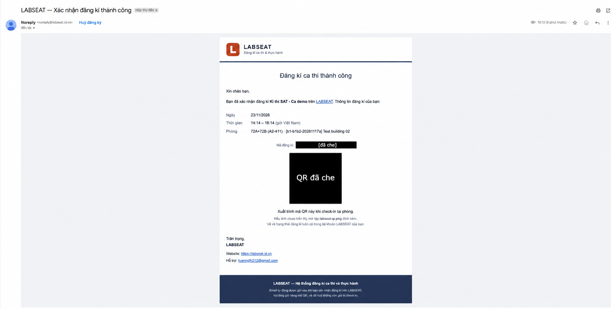

# B3 — Kiểm thử chức năng, regression và demo

## Mục tiêu

Thực hiện đúng **Prompt AI B3** trong [sprint](../../sprints/ke-hoach-nghiem-thu-4-ngay.md#b3-kiểm-thử-chức-năng-regression-và-demo): dùng dataset B1/B2, kiểm nghiệp vụ LABSEAT thật, ma trận expected/actual/evidence; phân biệt local/emulation/thiết bị thật; email giới hạn; SQL invariants read-only. Không chạy truncate/reset trên AWS.

**Chưa chốt toàn bộ B3.** Đã có kết quả chức năng/regression; X01–X03 chưa có cửa sổ tải/fault/restore và V01 chờ video người dùng cung cấp. Không đổi các mục đó thành PASS. Lần gom đầu ra `20261119T034356Z-b3-functional` không phải lần chạy lại test.

## Cấu hình

- AWS HTTPS: `https://labseat.id.vn`; run lịch sử API task definition `labseat-lab-api:10`, digest ghi trong [manifest](../../../evidence/assessment/20261119T034356Z-b3-functional/manifest.json).
- Regression: Python 3.12, PostgreSQL 16.16, Redis 7.4.11 disposable; database test/hostname test-db, không dùng DB AWS cho fixture destructive.
- Desktop: Edge/Playwright Core 1.65.1; controller Node offline tách khỏi HTTP thật.
- Điện thoại: iPhone XR/iOS/Safari theo người dùng và audit server; chưa có version OS/browser cụ thể hoặc video điện thoại mới.
- Bài bổ sung ngày 19/11 dùng hai lịch **Kì thi SAT - Ca demo** có sẵn, không tạo ca mới. Mật khẩu student475 hiện do người dùng tự chọn, không dùng lại password fixture cũ.
- Kết quả lịch sử trước đó có dùng ca synthetic B3, đã dọn theo yêu cầu. Không tái tạo các ca này để dựng bằng chứng mới.

## Cách kiểm và chạy lại

Ma trận [test-cases.csv](test-cases.csv) dùng đúng cột sprint: `case_id,task_id,scenario,preconditions,steps,expected,actual,status,evidence,issue`. Môi trường/role ghi trong preconditions; không dùng kết quả disposable làm bằng chứng đã chạy AWS.

- Regression: dùng suite có sẵn trong `tests/app` và `tests/app/ui.test.mjs`, chỉ trên runtime/DB/Redis disposable được guard cho phép. Sửa fixture avatar được giữ trong `tests/app/test_avatars.py`.
- AWS: dùng tài khoản B1/B2 đúng quyền; kiểm API trực tiếp và UI, hold/confirm/cancel, QR, realtime hai browser, CSV. Khi chạy lại phải dùng tài khoản còn hợp lệ và có lịch sử đúng bài; không dùng session/password đã bị reset hoặc ca đã xóa.
- Race suất cuối đã chạy bằng concurrent HTTP TestClient và DB disposable (R062 cùng các case concurrency), không ghi là race đã chạy trên AWS.
- Mail thật: cửa sổ riêng đã được người dùng cho phép, queue drain/quota trước gửi; hai API request bình thường qua publisher → SQS → worker Brevo, quan sát callback và người nhận. Không tự gửi lại job SKIPPED.
- Trước/sau tải/fault/restore: dùng `scripts/tests/db-invariants.sql` và probe nghiệp vụ đúng window ID/phase/target. Không tự chạy C3/C4/C5/B4/B5 để thay phần việc người khác.

## Kết quả thực tế và bằng chứng

| Nhóm B3 | Kết quả đã có | Evidence |
| --- | --- | --- |
| Account/login/logout/profile/verify/reset; khóa user | API auth/profile/lock đã kiểm. Người dùng xác nhận reset và login student475 bằng mật khẩu tự chọn; server challenge consumed/session cũ revoked. | [API](../../../evidence/assessment/20261119T034356Z-b3-functional/checks/results.json#/api), [reset/login](../../../evidence/assessment/20261119T034356Z-b3-functional/checks/results.json#/reset_login), [mail](../../../evidence/assessment/20261119T034356Z-b3-functional/checks/results.json#/email) |
| Quyền UI/API ba vai | API trái quyền bị chặn; bổ sung 24 assertions menu/deep link ba vai. | [API](../../../evidence/assessment/20261119T034356Z-b3-functional/checks/results.json#/api), [UI](../../../evidence/assessment/20261119T034356Z-b3-functional/checks/results.json#/ui_and_qr) |
| CRUD event/lịch/ảnh/phòng; trùng lịch | Có assertions tạo/sửa/xóa, input sai, sửa sơ đồ/capacity và guard lịch. | API; [regression](../../../evidence/assessment/20261119T034356Z-b3-functional/checks/results.json#/regression_junit_xml) |
| Admission/heartbeat/expiry | Join AWS; FIFO/heartbeat/lease expiry/rejoin/fail-closed trong regression. | API; regression; [controller](../../../evidence/assessment/20261119T034356Z-b3-functional/checks/results.json#/node_ui_log) |
| Hold/confirm/cancel/replay/race/hết chỗ/hết hạn | HTTPS có giữ/xác nhận/hủy/replay; race/expiry/suất cuối được kiểm disposable, không nhận là tải C3. | API; regression |
| QR/check-in sai ca/đóng/lặp | Có mã sai, scope, đóng/lặp. Bổ sung payload QR SAT nhập khi chọn lịch SAT khác: từ chối, ẩn xác nhận, không POST check-in, vé vẫn CONFIRMED. Đây là lookup mã QR, không phải lần quét camera mới. | [UI/QR](../../../evidence/assessment/20261119T034356Z-b3-functional/checks/results.json#/ui_and_qr), [phone](../../../evidence/assessment/20261119T034356Z-b3-functional/checks/results.json#/phone), API |
| Realtime hai browser; CSV | Browser độc lập cập nhật không reload; admin CSV đúng vé, student bị từ chối. | [browser](../../../evidence/assessment/20261119T034356Z-b3-functional/checks/results.json#/browser), [SAT realtime](../../../evidence/assessment/20261119T034356Z-b3-functional/checks/results.json#/realtime), API |
| Mail giới hạn, quota, callback, Inbox/Spam | Hai thư bổ sung DELIVERED, một attempt/thư, tổng attempts 2; người nhận xác nhận cả hai Inbox. Quota trước gửi 300. Email đã tắt lại. | [mail](../../../evidence/assessment/20261119T034356Z-b3-functional/checks/results.json#/email) |
| Invariants | Bảy truy vấn zero rows trong các snapshot B3 đã lưu. Không thay kết quả trước/sau fault/load/restore. | [invariants](../../../evidence/assessment/20261119T034356Z-b3-functional/checks/results.json#/invariants) |
| Probe tải/fault/restore | X01–X03 NOT_RUN; người dùng xác nhận chưa có lịch. | CSV |
| Video student → admin/staff check-in | V01 BLOCKED, chờ người dùng cung cấp. Không nhận hai ảnh hoặc video cũ là video mới hoàn chỉnh. | [manifest](../../../evidence/assessment/20261119T034356Z-b3-functional/manifest.json), [kịch bản](demo-script.md) |

Ma trận hiện **318 PASS, 18 NOT_RUN, 1 BLOCKED** (số dòng assertion/bằng chứng, không phải số yêu cầu độc lập). Toàn suite lịch sử: 275 PASS, 15 SKIP, 0 FAIL/ERROR; Node 39 PASS; API 33 PASS; browser 5 PASS. [Regression summary](../../../evidence/assessment/20261119T034356Z-b3-functional/checks/results.json#/regression_summary). 48 dòng kiểm deploy/migration/recovery/maintenance ngoài B3 đã bỏ khỏi ma trận; không xóa test gốc.

Hai ảnh người dùng đã nhận: [reset thành công](../../../evidence/assessment/20261119T034356Z-b3-functional/screenshots/password-reset-success.png) và email SAT có QR/nhãn Inbox. Bản email nguyên gốc chứa QR vé chưa check-in giữ private; nguồn/hash ở manifest. Đã thêm bản che QR/mã đăng ký theo yêu cầu người dùng; bản che là ảnh dẫn xuất có hỗ trợ AI, không thay thế bản gốc hoặc log giao thư. Không yêu cầu ảnh riêng cho mọi test khi đã có log hoặc video rõ ràng.

## Hạn chế và lỗi

| Mục | Mức độ / ảnh hưởng | Cách kiểm hoặc xử lý |
| --- | --- | --- |
| X01–X03 chưa chạy | Chưa đủ bằng chứng nghiệm thu phần cửa sổ phối hợp | Chạy probe nghiệp vụ và bảy invariants đúng trước/sau C3/C4/C5/B4/B5 khi nhóm có lịch. |
| Video chưa được cung cấp | Chưa đủ demo theo prompt | Người dùng gửi video trọn luồng trên ca có sẵn; ghi link kho nhóm/quyền truy cập/thời lượng. |
| 15 test SKIP | Thiếu prerequisite optional browser/SQS local và Redis restart/OOM | Giữ NOT_RUN, không chuyển PASS bằng bài gần giống; không restart Redis AWS để lấp phần thiếu. |
| Schema metadata | Đã lấy thêm bằng truy vấn read-only | RDS trả 0002_platform ngày 19/11/2026 lúc 04:01:04 UTC. Đây là snapshot hiện tại, không ghi ngược là đã thu tại run lịch sử. |
| Fixture avatar thiếu clean_db ban đầu | Lỗi thiết lập test, không phải lỗi runtime critical | Đã import fixture clean_db để mỗi test có dữ liệu sạch; suite cuối không còn fail/error. Chỉnh tên parameter chỉ phục vụ log đã hoàn nguyên vì không cần cho đầu ra B3. |
| Mật khẩu thử login 401 | Không xác nhận là lỗi sản phẩm | Người dùng chọn mật khẩu khác, đã xác nhận login; giữ log trung thực và phân biệt xác nhận thủ công. |

Chưa có lỗi runtime critical được xác nhận từ các case đã PASS. Không triển khai release app mới trong B3; nếu phát hiện/sửa lỗi runtime phải ghi release và nhờ C3 đo lại phần liên quan theo sprint.

## Hoàn tác và trạng thái cuối

Phân công staff bổ sung tạm để kiểm sai lịch đã gỡ; không check-in vé SAT của người dùng, vé vẫn CONFIRMED ở snapshot cuối. Email trở về worker revision 10/backend disabled sau hai thư, không phát lại skipped jobs. Mật khẩu tự chọn của student475 được giữ, không thu thập hoặc thay lại.

Đầu ra B3 chỉ gồm ba file functional/test-cases.csv, report.md, demo-script.md, cùng một thư mục bằng chứng `20261119T034356Z-b3-functional` có manifest/summary đúng quy cách chung. Đã xóa ba cây evidence cũ, các script/debug/backup trung gian thừa, hai script probe chưa dùng và video tự tạo cũ; không đụng tài liệu B1/B2, input ảnh của người dùng hoặc test gốc. Video để người dùng cung cấp sau.

Bộ thay đổi Git sau dọn: ba tài liệu B3; năm file evidence (manifest.json, summary.md, checks/results.json, ảnh reset, ảnh email đã che); một dòng sửa fixture test_avatars.py. Các log/assertion được gom nguyên nội dung trong results.json, các mục CSV trỏ tới section bằng JSON pointer. Một dòng import clean_db được giữ vì thiếu nó làm các test avatar dùng trùng dữ liệu và lỗi; không sửa chức năng/runtime hoặc chỉ tiêu nghiệm thu.

### Ảnh email vé đã che thông tin

Bản che thông tin có hỗ trợ imagegen; không dùng bản dẫn xuất để xác minh pixel hoặc dữ liệu ngoài hai vùng cần che. Bản gốc riêng/hash và callback/Inbox là nguồn đối chiếu chính. Ca SAT, ngày 23/11/2026, giờ 14:14–16:14 và phòng 72A+72B (A2-411) được đối chiếu với ảnh gốc.

## Phối hợp B4/B5 sau kiểm tra GitHub ngày 19/11/2026

Nhánh assessment/architecture ở b9bd5ab mới có A1; main ở ff2bb56 có A1 bàn giao cuối, A2 Hava và A3 ERD/sequence/ADR bản review. Chưa tìm thấy bằng chứng A4/C3/C4/C5 trên các remote đã kiểm. Các script tải có sẵn không chứng minh đã chạy tải hoặc fault; không suy thành viên chưa làm nếu họ chưa push. [Chi tiết nguồn](../../../evidence/assessment/20261119T034356Z-b3-functional/checks/results.json#/github_dependency_review).

Theo chỉ đạo người dùng mới nhất, phần chưa có kết quả được chờ theo kế hoạch. B4 ghi phụ thuộc diễn tập sau các fault ổn định; vì vậy chưa tạo DB/app/secret restored, chưa ghi incident/marker hay đo RPO/RTO. B5 cần app dùng DB restored nên cũng chưa thực thi. X01–X03 vẫn NOT_RUN.

Preflight kỹ thuật đã đọc AWS: source RDS available/private/encrypted/Multi-AZ, PostgreSQL16.13/db.t4g.micro, retention1 ngày, có LatestRestorableTime; quota DB còn39; class gp3 có thể đặt; KMS enabled; S3 versioning Enabled/public-block bật; mô phỏng IAM cần thiết allowed; ECS API/worker/publisher stable2/1/1. Quyền mô phỏng không được ghi thành restore PASS. SQL read-only trả schema0002_platform và bảy invariants zero rows. [Preflight](../../../evidence/assessment/20261119T034356Z-b3-functional/checks/results.json#/recovery_preflight).

Chưa phát sinh DB restored, không có phí lưu DB tạm từ lượt preflight này. Khi đủ điều kiện sẽ dùng DB/app/secret riêng, không đổi endpoint production; tạo đúng đầu ra recovery B4/B5 mà sprint yêu cầu và cleanup theo ID sau giữ bằng chứng.
