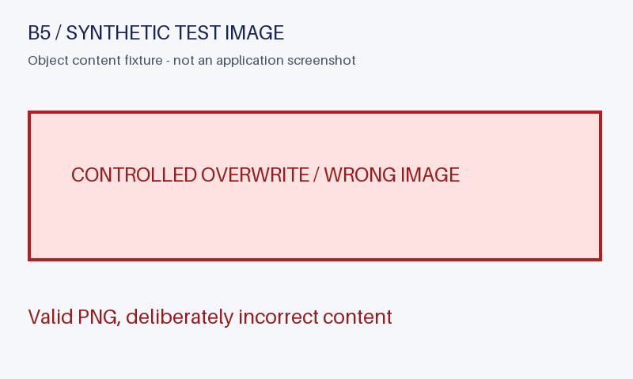
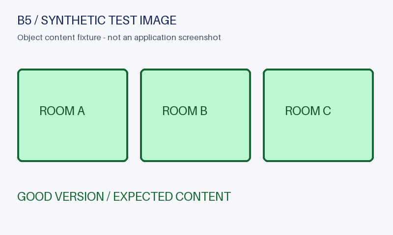

# B5 — Khôi phục ảnh S3 theo version

**Phần S3: PASS. B5 tổng thể: BLOCKED**, chưa kiểm liên kết DB và hiển thị qua app restored của B4. Làm theo [prompt B5](../../sprints/ke-hoach-nghiem-thu-4-ngay.md#b5-khôi-phục-ảnh-s3-theo-version-và-kiểm-liên-kết-db); không nhận S3 versioning thay backup database.

## Phạm vi và bằng chứng

Lượt `20261119T050938Z-b5-s3-restore` từ **2026-11-19T05:09:38.739888+00:00** đến **2026-11-19T05:10:04.533372+00:00**, region ap-southeast-2; account đã đối chiếu. Dùng một key mới, xác minh chưa có version/delete marker trước khi ghi. Không sửa ảnh đang dùng, DB, app, email hoặc cấu hình bucket.

- Bucket alias: `labseat-private-assets`; bucket thật/prefix giữ private.
- Key tương đối so với prefix app: `assessment/b5/76e341cb-2c1e-4ec7-9113-9906e44d660c/rooms/fixture.png`.
- SHA-256 full key: `ae991f70b5a86c14ada41fed28f3b7b30d8625676bbd6e6af6d5e601fb5ba718`.
- DB reference: **NOT_RUN**; chưa tạo bản ghi giả hoặc sửa DB nguồn để lấp phần thiếu.
- [Kết quả API/hash/private](../../../evidence/assessment/20261119T050938Z-b5-s3-restore/checks/results.json), [cleanup manifest](../../../evidence/assessment/20261119T050938Z-b5-s3-restore/cleanup-manifest.json).

## Bảng key/version/hash đã làm sạch

Cả ba dòng thuộc cùng key ở trên. Hash tính từ **bytes tải lại bằng authenticated S3 GET**, không dùng ETag thay SHA-256.

| Giai đoạn | Version ID | SHA-256 | Content type |
|---|---|---|---|
| before | `JmiLVA.SywILMOOJXEcJ5o78aTnlRBx_` | `17c0edfb565b41fbd252608537d227330abfd3aad8cf0a1d95db9f4fbea8e6ac` | image/png |
| overwritten | `AlvyXV5nlHipTnOftRwvrm66j2mV0P22` | `a7022db27680c96f426cdfb9ceecb72424948c8390146e882f7b24e7474f7a6a` | image/png |
| restored | `mU4g0DjmFqHmSSLfoJaW1q_8DVldRCqb` | `17c0edfb565b41fbd252608537d227330abfd3aad8cf0a1d95db9f4fbea8e6ac` | image/png |

## Kết quả thực tế

| Kiểm tra | Kết quả |
|---|---|
| Versioning / public access block | Enabled; cả4 public access block bật |
| Bản tốt ban đầu | Put ảnh synthetic, GET current đúng version/hash |
| Ghi đè lỗi có kiểm soát | PNG hợp lệ nhưng nội dung sai; GET current có version/hash khác bản tốt |
| Phục hồi | CopyObject từ version tốt vào chính key; tạo version current mới, không dùng delete để demo restore |
| Hash / content type | Bản restored trùng SHA-256 bản tốt, image/png; PNG signature/chunk CRC/zlib/kích thước800×480 hợp lệ |
| Quyền private | GET authenticated thành công; GET anonymous403; ACL không có public group |
| Cache | S3 GET cả3 giai đoạn trả Cache-Control:no-store; chưa kiểm browser/CDN/app cache |
| Cleanup | Xóa đúng3 version trong manifest sau lưu ảnh/hash; list lại còn0 version và0 delete marker |
| App và DB reference | NOT_RUN: B4 chưa có DB/app restored; images_verified=false |

“Lỗi” trong lượt này là nội dung ảnh S3 bị thay sai, đã đối chiếu bytes/hash; chưa phải quan sát lỗi qua UI app. Không kết luận B5 hoàn thành từ copy/put hoặc hash riêng lẻ.

## Ảnh trước / ghi đè / sau phục hồi

Các ảnh dưới là **object tải lại từ S3**, không phải screenshot app. Fixture tự tạo chỉ chứa sơ đồ synthetic và nhãn test, không có QR/thông tin người dùng.






## Cách tái tạo khi có app restored

1. Đọc bucket/prefix/versioning thật, kiểm account/owner; chọn key synthetic mới và manifest run riêng. Liên kết đúng bản ghi synthetic trên **DB restored**, không sửa ảnh/bản ghi người khác.
2. Put ảnh tốt, ghi version/hash; GET lại và kiểm ảnh qua app/DB reference. Sau đó put bản lỗi lên đúng key, GET lại và ghi lỗi quan sát từ app.
3. Dùng `s3api copy-object --copy-source BUCKET/KEY?versionId=GOOD_VERSION` để tạo current mới. Giữ các version cũ trong suốt diễn tập; không xóa version để làm bước phục hồi.
4. GET current, so SHA-256/content type/quyền private; đối chiếu DB reference và ảnh hiển thị qua app. Ghi cache headers/hành vi cache thực, xử lý cache trong phạm vi kiểm chứng nếu cần.
5. Chỉ khi cả ảnh và DB reference qua app đạt mới cập nhật images_verified=true ở B4 và dùng record RPO/RTO thật.
6. Giữ evidence trước cleanup. Liệt kê đúng key, so version/delete marker với manifest sở hữu rồi xóa chính các ID test; list lại phải trống. Không dùng delete recursive theo prefix hoặc sửa versioning/bucket policy.

Ví dụ lệnh cho riêng lớp S3: đặt trước các biến Bucket/Key/Owner/Profile/Region và Good/Wrong theo target synthetic mới, cùng cache/content type phù hợp. Kiểm versioning, account và key chưa tồn tại trước các lệnh ghi; không dùng key/version đã dọn trong bảng.

```powershell
$GoodVersion = aws s3api put-object --bucket $Bucket --key $Key --body $Good --content-type image/png --cache-control no-store --expected-bucket-owner $Owner --profile $Profile --region $Region --query VersionId --output text
$WrongVersion = aws s3api put-object --bucket $Bucket --key $Key --body $Wrong --content-type image/png --cache-control no-store --expected-bucket-owner $Owner --profile $Profile --region $Region --query VersionId --output text
$CopySource = "$Bucket/$Key" + "?versionId=" + [Uri]::EscapeDataString($GoodVersion)
$RestoredVersion = aws s3api copy-object --bucket $Bucket --key $Key --copy-source $CopySource --metadata-directive COPY --expected-bucket-owner $Owner --expected-source-bucket-owner $Owner --profile $Profile --region $Region --query VersionId --output text
aws s3api get-object --bucket $Bucket --key $Key --expected-bucket-owner $Owner --profile $Profile --region $Region .local/b5-current.png
Get-FileHash -Algorithm SHA256 -LiteralPath .local/b5-current.png
```

Sau **mỗi** request phải kiểm exit code, lưu VersionId ngay vào manifest riêng và GET/hash ảnh của giai đoạn đó trước khi tiếp tục. Cleanup dùng DeleteObjects với đúng Key+VersionId trong manifest sau khi đối chiếu ListObjectVersions; kiểm Errors và list lại. Các lệnh minh họa lớp S3 không thay bước DB reference/hiển thị app.

Phiên bản/version IDs trong bảng đã được dọn, không dùng chúng để chạy lại; lượt mới phải có key/version/manifest mới. Chuỗi thao tác S3 đã thực thi được lưu trong JSON theo timestamp; vẫn cần một lượt gắn DB/app restored để nghiệm thu trọn B5.

## Đối chiếu prompt và phần cần phối hợp

| Yêu cầu prompt B5 | Trạng thái / trách nhiệm |
|---|---|
| Synthetic tốt → ghi đè lỗi → copy version tốt thành current | PASS ở lớp S3; không dùng delete làm thao tác phục hồi |
| Key/version/hash, content type, quyền private | PASS; bảng và JSON đối chiếu object tải lại |
| Evidence và cleanup manifest | Đã có; xóa đúng3 version sau lưu evidence, không động key khác |
| Liên kết đúng bản ghi synthetic | NOT_RUN; phải làm trên DB restored của B4 |
| Hiển thị thật qua app, ảnh trước/sai/sau và hành vi cache | NOT_RUN; ảnh object hiện tại không thay bằng chứng UI |
| Cập nhật B4 | Đã giữ images_verified=false và RPO/RTO chưa chốt |

| Người / task | Cần bàn giao gì? | Người 2 kiểm hoặc làm tiếp gì? |
|---|---|---|
| Người3 — C4/C5 | Run ID/evidence, mốc kết thúc/rollback và xác nhận app/dependencies ổn định, không có tải/fault chạy song song | Chốt cửa sổ B4 theo sprint; không tự thực hiện fault thay người3 |
| Người2 — B4 | DB/app restored private, cùng digest, secret/cache/storage riêng, bản ghi synthetic và đường đọc ảnh qua app | Đây vẫn là phần người2; người3 không có trách nhiệm tạo app restored |
| Người2 — B5 | Khi B4 sẵn sàng: liên kết bản ghi, chạy lại toàn luồng tốt→sai→phục hồi qua app; so DB key/hash/MIME/private/cache, lưu evidence và cleanup | Chỉ sau khi thực tế đạt mới đặt images_verified=true; không đổi thành PASS chỉ vì S3 đã đạt |

Lượt độc lập hiện tại đã dọn hết key/version test. Vì vậy cần **một lượt tích hợp mới** trong app restored; không thể bổ sung vài ảnh UI sau đó để coi các version đã xóa là đã được kiểm qua app. Khi tích hợp nên lấy key/content type thực từ upload ảnh synthetic của app, giữ DB reference đúng key đó và đối chiếu bytes sau chuẩn hóa ảnh của app.

Đã kiểm cleanup lại bằng ListObjectVersions chỉ đọc lúc **2026-11-19T05:15:03.216220Z**: đúng key vẫn còn0 version/0 delete marker. Không ghi đè hoặc phục hồi thêm object để lặp lại bài S3 đã PASS. Chi tiết [review trong JSON](../../../evidence/assessment/20261119T050938Z-b5-s3-restore/checks/results.json#/review).

Không có yêu cầu phối hợp thêm với người1 từ phần đã kiểm. Chưa cần người dùng cung cấp ảnh/video ở giai đoạn này; evidence UI chỉ có ý nghĩa khi có app restored thật. Kết quả gộp tại [report B4](report.md#kết-quả-b5).

Nguồn: [AWS — copy version tốt thành current](https://docs.aws.amazon.com/AmazonS3/latest/userguide/RestoringPreviousVersions.html).

## Bổ sung từ người1 cho bước tích hợp B4/B5

A1 trên main ghi S3 lifecycle/TLS policy còn Pending. Phần liên quan bucket ảnh đã được xác minh thêm chỉ đọc05:21:46UTC: policy Deny non-TLS phủ bucket/objects, BucketOwnerEnforced, lifecycle noncurrent30 ngày; identity bucket khớp lượt S3 B5. App source private subnet có route S3 gateway endpoint. Nguồn/dữ liệu/hash tại [preflight B4](preflight.md#bổ-sung-từ-bàn-giao-người1-trên-main). Những thông tin này hỗ trợ chọn version, prefix và đường private cho lần tích hợp; chưa chứng minh recovery role/endpoint policy cho phép truy cập hoặc ảnh đã hiển thị qua app. Giữ images_verified=false.
