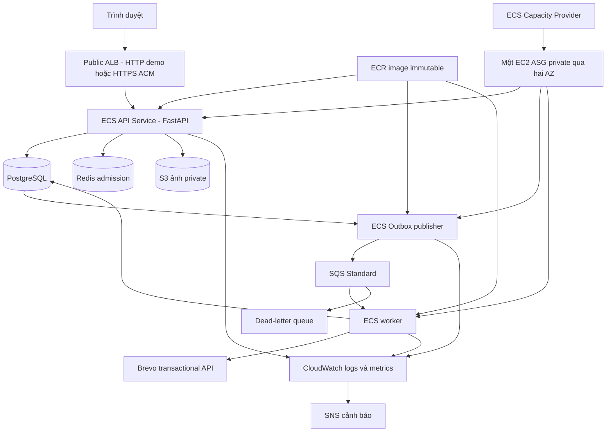
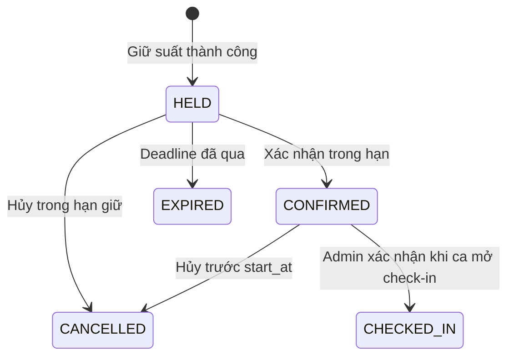
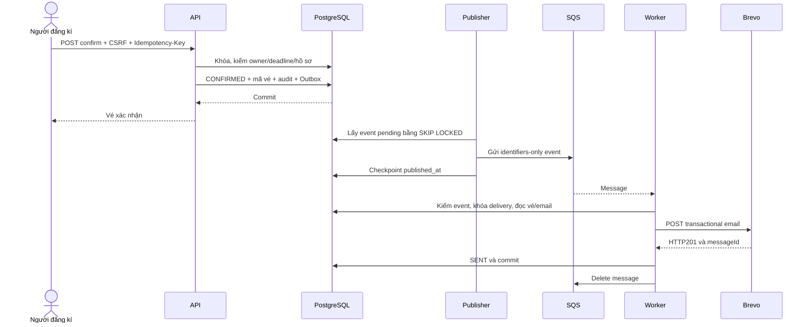
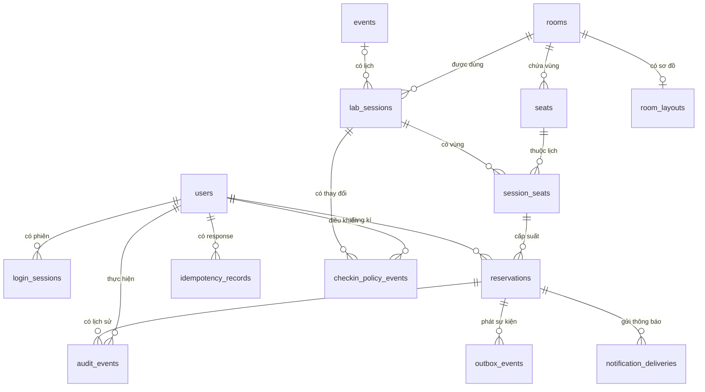

# ĐẶC TẢ HỆ THỐNG LABSEAT

**Phiên bản ứng dụng:** 0.6.0  
**Schema:** `0001_labseat`  
**Ngày đối chiếu source:** 16/11/2026  
**Phạm vi:** hệ thống hiện tại trong repository, gồm ứng dụng, cơ sở dữ liệu, giao diện, tác vụ nền và cấu hình hạ tầng.

Tài liệu mô tả hành vi đang được triển khai trong mã nguồn. Các thông số AWS là cấu hình và giả định vận hành của Terraform; chưa phải kết quả nghiệm thu trên AWS. Các chức năng chưa có được ghi rõ tại mục 21, không được hiểu là tính năng đã triển khai.

## Mục lục

1. [Mục tiêu và phạm vi](#1-mục-tiêu-và-phạm-vi)
2. [Thuật ngữ và mô hình nghiệp vụ](#2-thuật-ngữ-và-mô-hình-nghiệp-vụ)
3. [Tác nhân và phân quyền](#3-tác-nhân-và-phân-quyền)
4. [Kiến trúc tổng thể](#4-kiến-trúc-tổng-thể)
5. [Tài khoản, đăng nhập và hồ sơ](#5-tài-khoản-đăng-nhập-và-hồ-sơ)
6. [Quản lí ca và lịch đăng kí](#6-quản-lí-ca-và-lịch-đăng-kí)
7. [Phòng, sơ đồ và sức chứa](#7-phòng-sơ-đồ-và-sức-chứa)
8. [Hàng chờ và quyền vào chọn phòng](#8-hàng-chờ-và-quyền-vào-chọn-phòng)
9. [Giữ suất, xác nhận và hủy](#9-giữ-suất-xác-nhận-và-hủy)
10. [Vé, QR và check-in](#10-vé-qr-và-check-in)
11. [Email xác nhận qua Brevo](#11-email-xác-nhận-qua-brevo)
12. [Đặc tả giao diện](#12-đặc-tả-giao-diện)
13. [Mô hình và từ điển dữ liệu](#13-mô-hình-và-từ-điển-dữ-liệu)
14. [Giao dịch, đồng thời và idempotency](#14-giao-dịch-đồng-thời-và-idempotency)
15. [Danh mục API](#15-danh-mục-api)
16. [Quy ước dữ liệu và xử lí lỗi](#16-quy-ước-dữ-liệu-và-xử-lí-lỗi)
17. [Bảo mật và dữ liệu riêng tư](#17-bảo-mật-và-dữ-liệu-riêng-tư)
18. [Triển khai và cấu hình](#18-triển-khai-và-cấu-hình)
19. [Giám sát, sự cố và khôi phục](#19-giám-sát-sự-cố-và-khôi-phục)
20. [Kiểm thử và tiêu chí nghiệm thu](#20-kiểm-thử-và-tiêu-chí-nghiệm-thu)
21. [Vòng đời dữ liệu và giới hạn nghiệm thu](#21-vòng-đời-dữ-liệu-và-giới-hạn-nghiệm-thu)
22. [Nguồn tham chiếu trong repository](#22-nguồn-tham-chiếu-trong-repository)

## 1. Mục tiêu và phạm vi

LABSEAT phục vụ việc tổ chức và đăng kí ca thi, ca thực hành có giới hạn sức chứa. Người đăng kí xem ca, chọn phòng, giữ suất trong thời gian ngắn, xác nhận để nhận vé và sử dụng QR khi đến tham gia. Quản trị viên cấu hình ca, sơ đồ phòng, tiếp nhận người tham gia và xuất danh sách đăng kí.

Các mục tiêu nghiệp vụ:

- Không cấp số suất hiệu lực vượt sức chứa của phòng trong một lịch ca.
- Không cho một người giữ hoặc đăng kí đồng thời nhiều suất hiệu lực trong cùng lịch; kiểm tra thêm đăng kí hiệu lực cùng ca ở tầng nghiệp vụ.
- Không xác nhận lượt giữ đã hết hạn hoặc đã qua giờ đóng đăng kí.
- Cho phép quản trị viên quyết định thời điểm mở/đóng check-in riêng từng lịch ca.
- Cho quản trị viên xem vé và hồ sơ trước khi xác nhận check-in.
- Bảo toàn vé đã xác nhận khi email hoặc hệ thống hàng chờ gặp sự cố.
- Dùng chung dữ liệu, phiên đăng nhập và quyền truy cập giữa nhiều API instances.

Phạm vi chức năng gồm: tài khoản, hồ sơ, avatar; danh sách và tìm ca; quản lí ca/lịch/phòng; sơ đồ từ ảnh; hàng chờ tùy chọn; giữ suất/xác nhận/hủy; vé QR; tra cứu và check-in; CSV; email nền; công cụ triển khai và vận hành.

Hệ thống có hai loại ca: `exam` — ca thi; `practice` — ca thực hành. Đăng kí tài khoản không đồng nghĩa hoàn tất hồ sơ hoặc đã đăng kí một ca.

## 2. Thuật ngữ và mô hình nghiệp vụ

| Thuật ngữ | Ý nghĩa trong sản phẩm | Định danh trong source |
|---|---|---|
| Ca | Thông tin tên, loại, mô tả, địa điểm, ảnh và lịch phục vụ đăng kí | `Event` / `events` |
| Lịch ca | Bốn mốc thời gian, liên kết sơ đồ/phòng và cờ cho phép check-in | `LabSession` / `lab_sessions` |
| Địa điểm/sơ đồ chứa phòng | Đối tượng quản lí tập hợp vùng có thể chọn trên sơ đồ | `Room` / `rooms` |
| Phòng/vùng đăng kí | Vùng người dùng chọn, có tên và sức chứa | `Seat` / `seats`; trên sơ đồ ảnh là `zone` |
| Phòng thuộc lịch | Liên kết vùng đăng kí với lịch ca | `SessionSeat` / `session_seats` |
| Suất | Một vị trí trong sức chứa của vùng, được đánh số nội bộ | `Reservation.slot` |
| Lượt giữ/đăng kí | Bản ghi theo dõi người, lịch, phòng, thời hạn và trạng thái | `Reservation` / `reservations` |
| Vé | Thông tin đăng kí đã xác nhận, có mã ngẫu nhiên và QR | `ticket_code` và dữ liệu reservation |
| Admission | Quyền tạm thời được vào chọn phòng, trước khi tạo lượt giữ | Entry `ADMITTED` trong Redis |
| Outbox | Sự kiện được ghi cùng giao dịch xác nhận vé để xử lí nền | `outbox_events` |
| Delivery | Checkpoint xử lí email cho một đăng kí và loại thông báo | `notification_deliveries` |

Tên `Seat` là tên kỹ thuật. Trong luồng sơ đồ ảnh hiện tại, mỗi `Seat` có thể đại diện một phòng nhiều người, không phải một chiếc ghế vật lí. `slot` phân biệt các suất trong phòng và không phải số ghế người dùng tự chọn.

Luồng tạo ca qua giao diện tạo `Event`, đối tượng `Room` chứa sơ đồ và một `LabSession`. API quản trị cấp thấp cũng cho phép quản lí phòng/lịch riêng. Vì vậy tài liệu phân biệt `event_id`, `session_id`, `room_id`, `seat_id`; không dùng các UUID này thay thế cho nhau.

## 3. Tác nhân và phân quyền

Hệ thống lưu ba role ứng dụng: `student`, `staff` và `admin`. Staff chỉ xử lí check-in trong ca được phân công; admin quản trị toàn hệ thống. Khách chưa đăng nhập không có bản ghi role riêng. Người vận hành là tác nhân có quyền CLI/hạ tầng; quyền này không được cấp chỉ bằng role `admin` trên giao diện.

| Chức năng | Khách | Người đăng kí `student` | Quản trị `admin` | Người vận hành |
|---|---|---|---|---|
| Xem danh sách ca, phòng, sơ đồ công bố | Có | Có | Có | Theo quyền truy cập |
| Tự đăng kí tài khoản | Có, tạo role student | Có thể tạo phiên tài khoản khác | Có thể tạo phiên tài khoản khác | CLI tạo user riêng |
| Sửa hồ sơ/avatar | Không | Chỉ bản thân | Chỉ bản thân qua `/me` | Không có API sửa hồ sơ chung |
| Hàng chờ, giữ suất, xác nhận, hủy | Không | Đăng kí của bản thân | Đăng kí của bản thân | Không phải chức năng CLI đặt vé |
| Xem vé/QR cá nhân | Không | Chỉ bản thân | Chỉ bản thân | Không tự có quyền qua giao diện |
| Quản lí ca, lịch, phòng và sơ đồ | Không | Không | Có | Theo quyền quản trị được cấp |
| Tra cứu vé và hồ sơ người đăng kí | Không | Không | Có | Không tự có quyền HTTP |
| Mở/đóng và xác nhận check-in | Không | Không | Có | Không có công tắc check-in qua Terraform |
| Xuất CSV theo lịch | Không | Không | Có | Theo tài khoản admin |
| Bật/tắt/recover Redis admission | Không | Không | Không có nút HTTP | CLI có DB/Redis operator credentials |
| Build/deploy/rollback, secret và backup | Không | Không | Không cấp qua role ứng dụng | Theo IAM/OS/DB permissions |

Ẩn nút trên giao diện không thay thế kiểm tra quyền phía server. Các API ghi dữ liệu theo phiên đều kiểm CSRF. Tra cứu check-in dùng POST và cũng yêu cầu CSRF dù không thay đổi vé.

## 4. Kiến trúc tổng thể

Ứng dụng là **modular monolith**: một codebase, một image, các module nghiệp vụ tách trong source. API, publisher và worker triển khai thành ba ECS services; maintenance là ECS task có lịch riêng mỗi5 phút. Redis có ACL/connection riêng cho admission và Pub/Sub invalidation. PostgreSQL giữ nguồn sự thật.



### 4.1. Trách nhiệm thành phần

| Thành phần | Trách nhiệm | Dữ liệu không được giao làm nguồn chuẩn |
|---|---|---|
| FastAPI | Xác thực, kiểm quyền, giao dịch nghiệp vụ, HTTP và giao diện | Không giữ phiên/booking chỉ trong RAM |
| PostgreSQL | Tài khoản, session/CSRF hash, ca/phòng, reservation, policy, audit, Outbox, delivery | Là nguồn chuẩn nghiệp vụ |
| Redis | FIFO, admission quota, lease, heartbeat, readiness generation | Không quyết định vé đã xác nhận hoặc số suất đã commit |
| S3 / local shared storage | Bytes ảnh, poster, avatar, ảnh sơ đồ | Không lưu trạng thái booking |
| Publisher | Đẩy Outbox đủ điều kiện sang SQS và cập nhật checkpoint | Không gửi email trực tiếp |
| SQS/DLQ | Vận chuyển và redelivery tác vụ email | Không thay thế dữ liệu vé trong PostgreSQL |
| Worker | Kiểm event, lấy dữ liệu chuẩn, kiểm delivery và gọi Brevo | Không tin email/trạng thái do message tùy ý cung cấp |
| Brevo | Tiếp nhận yêu cầu email giao dịch | Không quyết định kết quả đăng kí/check-in |

### 4.2. Tổ chức source

- `app/main.py`: khởi tạo app, middleware, error handlers và gắn router.
- `app/modules`: auth, profiles, admin, sessions, rooms, queue, booking, tickets, checkin, notifications.
- `app/infrastructure`: PostgreSQL session/pool, Redis adapter, storage và observability.
- `app/models.py`, `app/schemas.py`, `app/image_maps.py`, `app/layouts.py`: dữ liệu và xử lí sơ đồ.
- `app/static`, `app/templates`: giao diện trình duyệt và template email.
- `migrations`: Alembic; `infra`: Terraform; `deploy`: local deployment CLI.
- `tests/app`, `scripts/tests`, `scripts/load`: kiểm thử, kiểm tra hạ tầng và tải.

## 5. Tài khoản, đăng nhập và hồ sơ

Luồng hiện tại: email bắt buộc khi đăng kí và được lưu chưa xác minh; mật khẩu không rỗng, không yêu cầu tối thiểu 12 ký tự. Banner đầu trang dẫn đến `#email-verification` để gửi liên kết xác minh. Chỉ yêu cầu gửi thư khi người dùng bấm gửi liên kết; không tự gửi khi tạo tài khoản. Đổi/đặt lại mật khẩu cũng chấp nhận mật khẩu ngắn không rỗng.

### 5.1. Đăng kí tài khoản — FR-AUTH-01

Khách mở `/` để nhận cookie CSRF trước đăng nhập. Form đăng kí gửi `username`, `email`, `password`, `password_confirm` cùng header `X-CSRF-Token` khớp cookie `labseat_pre_csrf`.

| Trường | Ràng buộc |
|---|---|
| Username | 3–100 ký tự; bắt đầu chữ/số ASCII; phần còn lại chữ/số hoặc `_`, `.`, `-`; không trùng username đã lưu |
| Password | 1–1024 ký tự; không chỉ gồm khoảng trắng |
| Email đăng kí | Bắt buộc, đúng định dạng; trim+lower; không trùng email chính đã lưu; ban đầu chưa xác minh |
| Password confirm | Khớp nguyên giá trị password |
| Role | Server luôn tạo `student`; client không được truyền thêm role |

Password không tự trim. Unique constraint giải quyết cả trường hợp hai yêu cầu đăng kí cùng username đồng thời. Thành công trả HTTP201 và tạo phiên đăng nhập; nếu request mang một phiên tài khoản trước đó thì phiên đó được loại bỏ sau khi đăng nhập tài khoản mới thành công.

Đăng kí tài khoản yêu cầu username, email, mật khẩu và xác nhận mật khẩu. Email được lưu ngay nhưng chưa được xác minh; banner dẫn đến phần yêu cầu gửi liên kết xác minh. Email cũng bắt buộc khi lưu hồ sơ. Mật khẩu được băm bằng Argon2, không lưu plaintext.

### 5.2. Đăng nhập và phiên — FR-AUTH-02

Đăng nhập nhận username 1–100 ký tự và password 1–1024 ký tự, có pre-login CSRF. Sai username/password trả thông báo chung `bad_credentials`, không phân biệt tài khoản có tồn tại hay không. Nhánh username không tồn tại vẫn thực hiện kiểm tra hash giả để giảm khác biệt xử lí.

Mỗi lần thành công tạo session token và CSRF token ngẫu nhiên. PostgreSQL chỉ lưu SHA-256 hash của hai token, user_id và thời hạn 8 giờ. Cookie session là HttpOnly; cookie CSRF cho phép JavaScript đọc để gửi header. Cookie dùng SameSite=Lax và Path=/; Secure được cấu hình theo môi trường.

Đăng xuất xóa bản ghi phiên hiện tại và cookie xác thực/CSRF. Một người có thể có phiên ở thiết bị khác; đăng xuất hiện tại không phải chức năng thu hồi mọi thiết bị. Không có refresh-token API.

### 5.3. Hồ sơ — FR-PROFILE-01

Hồ sơ được đọc bằng GET và lưu bằng **PUT `/me/profile`**. PUT là thay thế các trường hồ sơ: trường tùy chọn bị bỏ khỏi request nhận giá trị mặc định rỗng; không phải cập nhật từng trường kiểu PATCH.

| Trường | Bắt buộc khi lưu | Quy tắc |
|---|---|---|
| `full_name` | Không bắt buộc để lưu; cần cho ca thi | Tối đa150 ký tự; chuẩn hóa Unicode NFC và khoảng trắng; nếu có phải có chữ và không chứa ký tự điều khiển |
| `cccd` | Không bắt buộc, kể cả ca thi | Rỗng hoặc đúng12 chữ số ASCII |
| `email` | Có | 1–254 ký tự, đúng mẫu định dạng email của ứng dụng |
| `phone` | Không | Có thể rỗng; nhận khoảng trắng, dấu cách số, ngoặc, chấm/gạch; đổi `+84` thành `0`, sau chuẩn hóa phải là10 chữ số bắt đầu0 |
| Avatar | Không | Lưu qua API ảnh riêng |

`profile_complete = bool(full_name and (email or pending_email))` chỉ mô tả đủ thông tin; không thay thế `email_verified`. Mọi ca đều yêu cầu email đã xác minh trước queue join, hold và confirm mới. Ca thi còn yêu cầu họ tên; CCCD/điện thoại/avatar tùy chọn. API kiểm lại trong transaction, trả409 `profile_required` hoặc `email_verification_required`.

Email chuẩn hóa trim+lower; không gộp dấu chấm hoặc dấu cộng của Gmail. Email chính khác rỗng unique theo lower(btrim(email)); CCCD khác rỗng unique. Pending email chưa chiếm quyền sở hữu địa chỉ; nhiều tài khoản có thể yêu cầu cùng địa chỉ nhưng chỉ tài khoản xác minh thành công đầu tiên nhận được nó. CCCD đúng định dạng chưa chứng minh danh tính ngoài đời.

Đổi email cần mật khẩu hiện tại nếu đã có email chính. Lưu pending_email trước, giữ email chính đến khi xác minh. Thay pending email tăng email_version để vô hiệu hóa link cũ. Khi xác minh thành công, thay email chính atomically và gửi thông báo về địa chỉ trước đó.

### 5.4. Avatar — FR-PROFILE-02

Chỉ chủ tài khoản đọc/thay/xóa qua `/me/avatar`. Ảnh nhận JPEG/PNG/WebP tối đa5MiB, chịu kiểm tra pixel/decompression bomb; chuẩn hóa EXIF, nền và crop thành JPEG vuông256×256. Không chấp nhận SVG/GIF.

Object key nằm dưới `users/<user-id>/avatars/<uuid>.jpg`, có thể có S3 prefix cấu hình. Sau khi thay/xóa avatar, gỡ tham chiếu trong DB; common GC chỉ xóa object đủ24 giờ tuổi và qua cách ly thêm24 giờ. Khóa registry và kiểm lại tham chiếu bảo vệ upload/publish đồng thời. Xem [maintenance](deployment/maintenance.md).

### 5.5. Xác minh email và khôi phục mật khẩu — FR-AUTH-03

Challenge được lưu hash token, nonce, purpose, email_version và thời hạn; link dùng HMAC với AUTH_LINK_SIGNING_KEY tối thiểu32 ký tự, riêng môi trường. Không lưu plaintext token trong challenge hoặc đưa vào log. Liên kết đặt token trong URL fragment, giao diện xóa fragment bí mật khỏi history trước khi POST xác nhận; GET không tự tiêu thụ token.

| Luồng | Quy tắc |
|---|---|
| Xác minh email | Link24 giờ, một lần; request mới vô hiệu hóa link verify trước |
| Quên mật khẩu | Cần email đã xác minh; luôn trả202 thông điệp chung cho địa chỉ hợp lệ định dạng, dù không có tài khoản |
| Reset mật khẩu | Link30 phút, một lần; mật khẩu ít nhất12 ký tự, xác nhận trùng; thu hồi tất cả phiên/challenge |
| Đổi mật khẩu | Phiên+CSRF, kiểm mật khẩu cũ; thu hồi phiên khác, cấp phiên/CSRF mới cho thiết bị hiện tại |
| Gửi link |20/IP/giờ,5/email/giờ và tối thiểu60 giây giữa yêu cầu cùng loại/email |
| Login |50/IP/15 phút và10/username/15 phút |
| Token confirm |30/IP/giờ |

Rate limiter dùng counter PostgreSQL trong transaction độc lập đã commit, nên request bị từ chối không rollback bộ đếm. API dành một connection trong tổng budget3 cho counter, hai connection cho nghiệp vụ, overflow0. Mục đích là ngăn tất cả request giữ connection rồi chờ counter gây deadlock pool. Các process nền pool1 không khởi tạo counter engine.

### 5.6. Quản trị tài khoản — FR-ADMIN-USER-01

Admin tìm kiếm username/họ tên/email, lọc role, phân trang tối đa100 tài khoản/request và xem hồ sơ có audit. Thay role hoặc ACTIVE/LOCKED cần lý do, audit before/after và thu hồi phiên/challenge. Gỡ role staff xóa phân công để tránh cấp lại quyền cũ ngoài ý muốn. Tài khoản ANONYMIZED không thể mở khóa phục hồi. Advisory lock và thứ tự khóa User ổn định bảo vệ invariant còn ít nhất một admin ACTIVE.

Chỉ admin gán/thu hồi staff theo LabSession. Staff cần ACTIVE, role staff và email đã xác minh; chỉ tra vé, đọc avatar và xác nhận check-in trong ca được giao. Không được xuất CSV, quản trị ca/tài khoản hoặc mở/đóng check-in. CCCD mặc định che, email/điện thoại không trả; bấm xem CCCD đầy đủ ghi audit. Confirmation kiểm lại assignment dưới khóa, kể cả request lặp. Người vận hành IAM không tự có role HTTP.

## 6. Quản lí ca và lịch đăng kí

### 6.1. Thông tin ca — FR-SESSION-01

Quản trị viên tạo/sửa ca bằng multipart gồm trường `data` chứa JSON và file `poster`.

| Thuộc tính | Ràng buộc |
|---|---|
| Tên ca | 1–100 ký tự |
| Loại | `exam` hoặc `practice` |
| Địa điểm `venue` | 1–120 ký tự |
| Địa chỉ | Tối đa300 ký tự; có thể rỗng |
| Mô tả | Tối đa10.000 ký tự; có thể rỗng; hiển thị dạng text |
| Poster | Bắt buộc khi tạo; JPEG/PNG/WebP tối đa5MiB; chuẩn hóa JPEG1280×720 |
| Lịch | Bắt buộc khi tạo ca qua giao diện; sửa có thể bỏ để giữ lịch |

Sửa ca có thể bỏ poster để giữ ảnh. Tạo ca qua luồng quản trị tạo thêm địa điểm chứa sơ đồ và một lịch. Endpoint danh sách công khai chỉ trả ca đã có `session_type` và `poster_key`; không có công tắc xuất bản riêng trong model.

### 6.2. Quy tắc thời gian — BR-TIME-01

Mọi lịch phải thỏa:

```text
open_at < close_at <= start_at < end_at
```

| Mốc | Ý nghĩa |
|---|---|
| `open_at` | Bắt đầu cho tạo lượt giữ |
| `close_at` | Dừng tạo hold và xác nhận mới |
| `start_at` | Bắt đầu ca; hạn hủy vé CONFIRMED |
| `end_at` | Kết thúc ca; cũng là hạn đọc ảnh QR hosted trong email |

API nhận datetime có timezone; timestamp trong DB là timezone-aware và connection dùng UTC. Giao diện/email hiển thị giờ Việt Nam. Đồng hồ client phục vụ countdown; điều kiện cuối cùng dùng thời gian PostgreSQL. Redis dùng đồng hồ Redis cho admission.

Tại đúng `close_at`, giữ suất/xác nhận mới không còn hợp lệ. Tại đúng `start_at`, hủy vé CONFIRMED không còn hợp lệ. Check-in không dùng hai điều kiện thời gian này; quy định ở mục10.

### 6.3. Tìm và hiển thị ca — FR-SESSION-02

Danh sách có tab ca thi/thực hành. Tìm kiếm phía trình duyệt theo tên, địa điểm hoặc địa chỉ, không phân biệt hoa thường theo locale tiếng Việt. Các ca được sắp theo giờ bắt đầu và chia nhóm: sắp đăng kí, đang mở đăng kí, đã qua thời hạn đăng kí.

Thẻ ca có ảnh, tên, địa điểm và giờ mở đăng kí. Chi tiết có mô tả, địa điểm, thời gian đăng kí/diễn ra. Nút đăng kí chỉ bật trong cửa sổ đăng kí; API vẫn tự kiểm thời gian khi client gọi trực tiếp.

### 6.4. Sửa, xóa và trùng lịch — FR-SESSION-03

Hai lịch cùng `room_id` không được có khoảng diễn ra giao nhau theo điều kiện `existing.start_at < new.end_at AND existing.end_at > new.start_at`. Một ca kết thúc đúng lúc ca tiếp theo bắt đầu được phép.

Khi đã có reservation, kể cả đã hủy/hết hạn, việc đổi lịch hoặc xóa lịch bị chặn để bảo toàn quan hệ dữ liệu. Đường sửa lịch cấp thấp không cho chuyển `room_id`. Luồng sửa ca vẫn có thể giữ nguyên lịch và sửa các thuộc tính ca theo API. Luồng tác giả ca yêu cầu hợp nhất trước khi chỉnh nếu ca đang có nhiều lịch.

Mở/đóng check-in là thao tác riêng, không đổi lịch, vẫn dùng được sau khi có đăng kí. Hiện không có DELETE `/admin/events/{id}` hoặc chức năng lưu trữ ca riêng.

## 7. Phòng, sơ đồ và sức chứa

### 7.1. Phòng có sức chứa — FR-MAP-01

Người đăng kí chọn một vùng phòng và nhận một suất trong sức chứa vùng đó. Mỗi vùng có tên1–30 ký tự và capacity1–100.000; tên vùng không trùng trong cùng sơ đồ. Backend quản lí slot số nguyên từ0 tới capacity−1.

Đổi/xóa cấu hình vùng sau khi đã có reservation của địa điểm bị khóa. Khóa xét cả lịch sử reservation, không chỉ vé đang hiệu lực. Vì vậy việc hủy tất cả vé không tự mở lại quyền sửa sơ đồ.

### 7.2. Nhận diện từ ảnh — FR-MAP-02

Quản trị chọn ca, tải ảnh PNG/JPEG/WebP tối đa5MiB, mỗi chiều tối đa2048px, chọn diện tích tối thiểu mặc định400px² trong khoảng16–10.000. Backend dùng OpenCV với một thread để phát hiện tứ giác lồi khép kín: chữ nhật, vuông, bình hành và tứ giác hợp lệ.

Hệ thống hỗ trợ tách phòng có chung cạnh nếu ảnh có đường biên phân chia. Màu tô/nền không phải quy tắc xác định sức chứa. Không tìm thấy vùng vẫn có thể dùng ảnh để kéo thêm phòng thủ công; không bảo đảm nhận diện đúng mọi ảnh.

Upload/nhận diện tạo ảnh PNG và trả bản nháp gồm `image_key`, `image_url`, kích thước, `revision`, detector `quadrilateral-v1` và vùng gợi ý. Bước này chưa xuất bản các phòng mới vào sơ đồ sử dụng cho booking.

### 7.3. Chỉnh sửa và lưu — FR-MAP-03

Quản trị chọn vùng để đặt tên/sức chứa, xóa vùng khỏi bản nháp hoặc kéo tạo vùng chữ nhật. Tọa độ được quy đổi về pixel ảnh gốc. Mỗi vùng phải có đúng4 điểm nguyên theo chu vi, nằm trong ảnh, không tự cắt, lồi và có diện tích hợp lệ. Các vùng không chồng lấn; chung cạnh được phép. Có tối đa500 vùng và100.000 mask runs cho một sơ đồ.

Khi lưu, server kiểm image key thuộc đúng room, revision, hình học, tên/id và sức chứa. Server dựng lại geometry/mask; không tin runs hoặc bounding box từ client. Lưu thành công cập nhật Seat/SessionSeat và tăng layout revision trong giao dịch.

Nếu revision không khớp trả409 `layout_conflict`; người dùng phải tải lại. Thay đổi chưa lưu được cảnh báo khi đổi ca/rời trang. Ảnh bản nháp chưa xuất bản chỉ admin đọc được; ảnh đã gắn vào sơ đồ công bố được đọc qua proxy ứng dụng.

### 7.4. Cập nhật số suất — FR-MAP-04

API availability tính đã chiếm từ CONFIRMED, CHECKED_IN và HELD chưa hết hạn, rồi trả `capacity`, `remaining`, `available` và `layout_revision`. SSE qua Redis Pub/Sub gửi invalidation chỉ chứa session_id; client đọc snapshot DB mới, giữ cấu trúc ảnh/SVG nếu geometry không đổi. Heartbeat15 giây, resync30 giây; mất stream dùng polling5 giây và reconnect backoff tối đa30 giây. `next_change_at` lên lịch đọc lại khi hold/deadline hết hạn dù không có mutation. Stream đóng khi ẩn tab/rời màn hình và không giữ transaction hoặc connection DB suốt kết nối. Khi vùng hết suất, lựa chọn không còn hợp lệ được bỏ; kết quả availability chỉ là snapshot, không phải cam kết giữ suất.

API cũng có sơ đồ lưới với phần tử seat/board/door/label, kích thước tối đa40×40 và500 phần tử. Đây là API cấu hình phòng; luồng tác giả ca trên giao diện sử dụng trình sửa sơ đồ ảnh. Không trộn request lưới và request ảnh khi sửa cùng sơ đồ.

## 8. Hàng chờ và quyền vào chọn phòng

### 8.1. Phân biệt admission với giữ suất — FR-QUEUE-01

Admission giới hạn số người được chọn phòng đồng thời trong **mỗi lịch ca**; không trừ sức chứa phòng. Hold chỉ xuất hiện khi PostgreSQL chấp nhận yêu cầu giữ suất. Policy là một cấu hình chung trong PostgreSQL; dữ liệu xếp hàng trong Redis tách theo epoch và session_id.

| Policy | Mặc định | Khoảng hợp lệ |
|---|---|---|
| `enabled` | false | Bật/tắt qua operator CLI |
| `capacity` | 10 người được admission/lịch | 1–100 |
| `selection_seconds` | 120 giây | 1–600 |
| `heartbeat_seconds` | 5 giây | 1–30 |
| `waiting_grace_seconds` | 60 giây | Lớn hơn heartbeat và không quá600 |

Khi policy tắt, các thao tác admission trả trạng thái DISABLED và không cần kết nối Redis. Quy tắc hồ sơ ca thi và điều kiện booking vẫn được kiểm ở API tương ứng.

### 8.2. FIFO, lease và heartbeat — FR-QUEUE-02

Join dùng danh tính từ phiên đăng nhập, không nhận user_id hay quyền admission do client truyền. Khi bật queue, join cần lịch đang mở và người dùng chưa có đăng kí hiệu lực trong lịch. Lua atomically xếp FIFO theo sequence, cấp admission khi còn quota và trả số người phía trước nếu đang chờ.

Các trạng thái có thể trả gồm DISABLED, WAITING, ADMITTED, EXPIRED, LEFT, CONSUMED, CLOSED, NONE. Người WAITING cần heartbeat; vắng quá grace có thể bị loại. Admission có deadline `min(now + selection_seconds, close_at)`. Heartbeat không kéo dài admission lease.

Lua giới hạn hàng WAITING ở1.000 entries và hash entries ở10.000 mỗi namespace lịch/epoch. Mỗi call dọn tối đa100 admission hết hạn và100 người chờ bỏ phiên; còn backlog hết hạn vượt phần dọn thì từ chối an toàn thay vì cấp vượt quota. Dữ liệu namespace có TTL tới sau end_at1 giờ.

Khi hold thành công và DB đã commit, ứng dụng consume admission theo generation. Consume Redis lỗi sau commit không làm mất hold. DB rollback thì không consume admission. Người giữ suất có thể xác nhận/hủy theo DB mà không phải xin admission mới.

### 8.3. Fail-closed và recovery — BR-QUEUE-01

Khi queue đang bật, mất Redis, sai epoch/policy version, thiếu marker hoặc khác Redis run_id làm admission/hold mới bị từ chối. Hệ thống không tự chuyển sang bỏ qua queue. Vé và hold đã commit được bảo toàn; confirm/hủy không phụ thuộc Redis admission.

Người vận hành dùng `python -m app.cli queue-settings` và `queue-recover`, với actor/reason không chứa bí mật. Chuyển policy dùng advisory lock độc quyền, phối hợp với shared lock của guard. Recovery bắt đầu bằng đánh dấu pending, đổi epoch/version và chờ ít nhất selection lease trước khi finish hoặc disable. Finish chuẩn bị marker bằng operator credentials và kiểm lại bằng runtime credentials.

Mọi thay đổi policy lưu before/after và lý do vào `queue_policy_events`. Không có API/nút admin HTTP để tự bật queue, và không được tự tạo marker hoặc FLUSHALL để bỏ qua recovery.

## 9. Giữ suất, xác nhận và hủy

### 9.1. Máy trạng thái — BR-BOOKING-01



EXPIRED có thể là trạng thái được diễn giải khi đọc: bản ghi vẫn HELD nhưng deadline đã qua. Khi có thao tác giữ suất liên quan, backend mới dọn các hold hết hạn cần thiết và ghi trạng thái/audit. Không có yêu cầu cron phải chuyển toàn bộ hold hết hạn ngay đúng giây deadline.

### 9.2. Giữ suất — FR-BOOKING-01

Điều kiện: phiên hợp lệ và CSRF; session/seat hợp lệ và liên kết với nhau; hồ sơ đủ nếu ca thi; `open_at <= DB_now < close_at`; không có đăng kí hiệu lực xung đột; phòng còn slot; có admission còn hạn nếu policy bật.

Thời hạn giữ được tính:

```text
hold_expires_at = min(DB_now + 180 giây, close_at)
```

Server trả `hold_id`, `expires_at`, `server_time`. Không kéo dài hold khi gọi lại cùng hold đang tồn tại. Người đang giữ ở một phòng không tự chuyển được sang phòng khác bằng cách gửi hold mới; cần hủy lượt giữ hợp lệ rồi thao tác lại. Hết slot trả409 `sold_out`.

### 9.3. Xác nhận — FR-BOOKING-02

Chủ đăng kí xác nhận khi trạng thái HELD, `DB_now < hold_expires_at` và `DB_now < close_at`. Ca thi kiểm lại hồ sơ. Trong cùng transaction, server đổi CONFIRMED, cấp `ticket_code` ngẫu nhiên bằng token_urlsafe(32), thêm audit và Outbox `ReservationConfirmed`.

Confirm lặp trên CONFIRMED hoặc CHECKED_IN trả lại vé hiện có; không cấp mã mới hoặc tạo event xác nhận thứ hai. Confirm sau expiry, sau giờ đóng, sau hủy hoặc sai chủ sở hữu bị từ chối. HTTP thành công không chờ email.

### 9.4. Hủy — FR-BOOKING-03

| Trạng thái | Điều kiện hủy |
|---|---|
| HELD | Chưa hết hạn hold |
| CONFIRMED | Trước start_at |
| CANCELLED | Trả lại trạng thái đã hủy; không thêm audit lần hai |
| CHECKED_IN | Không được hủy |
| EXPIRED hoặc HELD đã quá hạn | Không được hủy như hold còn hiệu lực |

Hủy giải phóng suất hiệu lực nhưng giữ bản ghi và lịch sử. Mã QR có thể còn trong ảnh/cache; trạng thái DB mới là quyết định hợp lệ. Không có hoàn tác check-in hoặc chuyển vé sang người khác.

### 9.5. Trình tự xác nhận và email



## 10. Vé, QR và check-in

### 10.1. Vé cá nhân và CSV — FR-TICKET-01

Người dùng xem toàn bộ đăng kí của bản thân bằng `/me/tickets`, gồm ca, phòng, trạng thái, deadline, mã vé nếu có và thời điểm check-in. HELD quá hạn được hiển thị EXPIRED. API QR xác thực chủ sở hữu và yêu cầu đã có `ticket_code`; QR là PNG chứa chính mã vé, không chứa hồ sơ người đăng kí.

Quản trị xuất CSV theo `session_id`: reservation_id, username, seat_code, status, checked_in_at. CSV dùng UTF-8 BOM và bảo vệ các giá trị có thể mở đầu công thức spreadsheet. Export không mặc định đưa CCCD/email/điện thoại vào file.

### 10.2. Công tắc check-in — FR-CHECKIN-01

Trong Quản lí ca, chọn ca đã lưu và bấm Mở check-in hoặc Đóng check-in. Thao tác lưu ngay, không cần bấm Lưu ca và không thay đổi lịch. `checkin_enabled` mặc định false, lưu ở PostgreSQL và dùng chung mọi API task.

Check-in không có gate15 phút hoặc giờ bắt đầu. Effective policy là cờ mở AND ca ACTIVE AND chưa tới deadline: `end_at` (mặc định ca mới), `custom` (mốc UTC do admin chọn) hoặc `manual` (không tự đóng). Ca hiện có được migrate sang manual. Muốn tiếp nhận sau deadline, admin đặt mốc tương lai hoặc chọn manual. Deadline được kiểm bằng DB clock ngay tại POST, không phụ thuộc scheduler. Công tắc này không mở lại đăng kí hoặc kéo dài deadline hủy/confirm. Đóng ca không hoàn tác các vé đã check-in.

Thay đổi thực sự được ghi `checkin_policy_events` cùng transaction. Gửi lại trạng thái không đổi không tạo thêm audit policy.

### 10.3. Tra cứu trước, xác nhận sau — FR-CHECKIN-02

Quản trị quét QR hoặc nhập `ticket_code`/UUID đăng kí20–100 ký tự. Nhập tay tự tra cứu sau khoảng450ms ngừng gõ, hoặc bấm Tra cứu vé. Quét thành công dừng camera và tra cứu; không tự check-in.

Kết quả gồm ba nhóm:

| Nhóm | Dữ liệu |
|---|---|
| Vé | Mã đăng kí, mã vé nếu có, trạng thái, thời hạn hold, checked_in_at |
| Ca/phòng | Tên, lịch, địa điểm chứa sơ đồ, mã/tên vùng đã chọn, giờ diễn ra, cờ mở check-in |
| Hồ sơ | Username, họ tên, CCCD, email, điện thoại tùy chọn, avatar nếu có |

Server trả thêm `can_check_in` và `reason`. Nút Xác nhận check-in chỉ hiện khi **CONFIRMED và effective check-in đang mở**. HELD, EXPIRED, CANCELLED, CHECKED_IN vẫn có thể tra cứu nhưng không có nút xác nhận.

Khi bấm xác nhận, server kiểm lại vé/policy dưới khóa. Nếu ca đã đóng sau lookup, POST từ chối409 `checkin_closed`; frontend tải lại thông tin. Kết quả lookup không phải quyền check-in có hiệu lực mãi.

Xác nhận thành công đổi CHECKED_IN, ghi `checked_in_at` bằng DB clock và audit. Gọi lại trả thời điểm đã lưu, không ghi thêm check-in. Lookup, ảnh avatar và POST xác nhận dành cho admin hoặc staff trong scope ca được giao; lookup và xác nhận cần CSRF. Staff chỉ nhận CCCD che, có thao tác reveal ghi audit.

Frontend xóa hồ sơ hiển thị khi đổi mã/đăng xuất, bỏ response lookup trả muộn cho mã khác và chặn bấm xác nhận lặp khi request đang chạy. Nội dung tên/hồ sơ được chèn bằng text, không render thành HTML.

### 10.4. Camera QR — FR-CHECKIN-03

Nút Quét QR mở dialog cỡ khoảng420px tối đa, phù hợp viewport. Video có vùng vuông sáng76% ở giữa, phần ngoài làm tối và dải quét animation. Decoder ưu tiên BarcodeDetector khi hỗ trợ và fallback jsQR đóng gói local. Camera ưu tiên hướng sau; ảnh/video không gửi lên server để giải mã.

Đọc được mã, đóng dialog, Escape, bấm backdrop, điều hướng hoặc đăng xuất đều dừng stream. Quyền camera trả muộn không được mở lại scanner đã đóng. Có phương án chụp/chọn ảnh JPEG/PNG/WebP tối đa5MiB,20megapixel và nhập mã thủ công. Animation tôn trọng reduced-motion.

HTTP localhost/127.0.0.1 có thể dùng live camera khi được cấp quyền. HTTP qua IP/domain khác bị giới hạn secure context của trình duyệt; dùng ảnh hoặc mã thủ công. HTTPS hỗ trợ camera tùy thiết bị/quyền. Hệ thống không tự bỏ qua giới hạn này bằng JavaScript.

## 11. Email xác nhận qua Brevo

### 11.1. Nội dung và cấu hình — FR-MAIL-01

Email xác nhận dùng logo LABSEAT, tên ca/loại ca, thời gian Việt Nam, phòng, mã đăng kí, QR, website và footer hệ thống; địa chỉ hỗ trợ là tùy chọn. Template HTML dùng table/inline CSS và escape dữ liệu tên/phòng. Không gửi CCCD, số điện thoại, mật khẩu hoặc toàn bộ hồ sơ.

Worker gọi `POST https://api.brevo.com/v3/smtp/email` bằng API key, không phải SMTP key. Sender email/name, public website và support email cấu hình riêng. Key nhận từ biến secret hoặc file secret; không được cấu hình đồng thời cả hai nguồn key. Local mặc định dùng mock, không gửi email thật.

### 11.2. Durable jobs, Outbox và webhook — FR-MAIL-02

Confirm ghi Outbox cùng transaction vé; publisher gửi envelope ID vào SQS. Worker chuyển event sang EmailJob UUID ổn định theo reservation, checkpoint SENT/SKIPPED đã có được giữ nguyên và không phát lại. Verification/reset/cancel/resend/retention tạo EmailJob+PlatformEvent cùng transaction nghiệp vụ. Publisher ưu tiên email, checkpoint publication và chấp nhận duplicate nếu mất ACK; worker xử lí job theo khóa.

Worker commit claim SENDING trước khi gọi HTTP, không giữ DB connection trong network I/O. Job lưu snapshot nội dung trước lần gửi đầu để retry cùng payload. Header idempotencyKey UUID/job ID được giữ ổn định; ACK201 chuyển ACCEPTED, không đồng nghĩa DELIVERED. Concurrent claim trả lỗi có thể retry; lease tối thiểu30 giây bảo vệ request đang gửi. Retry lỗi provider không thay đổi trạng thái vé.

POST `/webhooks/brevo` yêu cầu Bearer BREVO_WEBHOOK_TOKEN tối thiểu32 ký tự, so sánh constant-time, body≤128KiB, tối đa100 event. API lưu inbox tối thiểu, dedup message-id/event/time, không lưu raw payload chứa PII. Worker/maintenance đối chiếu job bằng X-Mailin-custom hoặc message-id, xử lí event đến lặp/đảo thứ tự. Event request cũ không hạ DELIVERED; hard bounce, blocked, complaint tạo suppression. Unmatched inbox giữ pending chờ đối chiếu, không cản event đã nhận diện.

### 11.3. Retry, resend và email không tồn tại — BR-MAIL-01

Brevo công bố idempotency TTL30 phút; nếu gửi có kết quả chưa rõ quá29 phút, job dừng UNKNOWN để đối chiếu. `duplicate_parameter` không bị coi là ACK giao thư. Không tự gửi lại sau cửa sổ bảo vệ. Xem [tài liệu Brevo](https://developers.brevo.com/docs/heterogenous-versions-batch-emails).

Email không tồn tại có thể được tiếp nhận rồi bounce. Hard bounce/suppression dừng gửi mới tới địa chỉ đó; soft bounce/deferred chỉ cập nhật delivery, không tạo job gửi lại tự động. SQS có maxReceiveCount/DLQ; UI gửi lại chỉ theo thao tác người dùng/admin, cooldown60 giây, tối đa3 yêu cầu/ngày/vé, phải là vé và địa chỉ đã xác minh hợp lệ. Admin có lịch sử email, gửi lại và gỡ suppression có audit. Không xóa delivery hàng loạt hoặc hứa exactly-once/inbox delivery.

### 11.4. QR trong email — FR-MAIL-03

Email có PNG attachment `labseat-qr.png` chứa mã vé, đồng thời dùng ảnh hosted có chữ kí HMAC-SHA256 riêng theo reservation. Hosted URL không đặt trực tiếp ticket_code hoặc email trong path. Capability này chỉ cho đọc ảnh vé đó, không đăng nhập hoặc tự check-in.

Hosted QR trả404 nếu chữ kí sai, vé không tồn tại/chưa có mã, vé không còn CONFIRMED/CHECKED_IN hoặc đã tới end_at. File attachment và QR trong tài khoản có cơ chế đọc riêng; quyết định check-in vẫn dựa trạng thái và cờ quản trị. Mail client/cache có thể còn ảnh sau khi vé bị hủy, nhưng server vẫn từ chối check-in.

`EMAIL_PUBLIC_BASE_URL` khi gửi thật phải là HTTPS, không credentials/query/fragment và phục vụ đúng ứng dụng chứa vé. Điều này độc lập với việc local/demo dùng HTTP để truy cập giao diện. URL ảnh vé là dữ liệu riêng tư; không đưa raw URL vào log hoặc catalogue.

## 12. Đặc tả giao diện

Giao diện tiếng Việt được phục vụ trực tiếp tại `/`, sử dụng HTML/Jinja2, CSS và JavaScript cùng origin với API. Điều hướng dùng hash; không cần sticky session giữa các API tasks.

| Khu vực | Nội dung và hành vi chính |
|---|---|
| Header/tài khoản | Logo LABSEAT; đăng nhập khi chưa có phiên; avatar/họ tên hoặc username khi đăng nhập; menu Tài khoản/Đăng xuất |
| Đăng nhập/đăng kí | Dialog, đổi chế độ, kiểm xác nhận mật khẩu, hiển thị lỗi server; hỗ trợ focus và bàn phím |
| Danh sách ca | Tab ca thi/thực hành, tìm kiếm, các nhóm trạng thái và thẻ ngang; nút cuộn khi nội dung vượt khung |
| Chi tiết ca | Mô tả, thời gian, địa điểm và nút đăng kí theo cửa sổ thời gian |
| Hàng chờ | Trạng thái, số người trước, heartbeat và deadline khi đến lượt; rời hàng chờ |
| Chọn phòng | Sơ đồ, danh sách phòng, tổng/còn suất, lựa chọn và nút giữ suất |
| Lượt giữ | Countdown theo server_time, thông tin phòng, xác nhận hoặc hủy; khôi phục dữ liệu còn hiệu lực khi tải lại |
| Ca đã đăng kí | Danh sách vé/trạng thái, QR, hủy khi hợp lệ; đọc trạng thái mới từ API |
| Hồ sơ | Họ tên, CCCD, email bắt buộc, điện thoại tùy chọn, profile_complete, đổi/xóa avatar |
| Quản lí ca | Chọn/tạo ca, nội dung/ảnh/lịch, trạng thái lưu và nút Mở/Đóng check-in riêng |
| Sơ đồ phòng | Chọn ca, tải/nhận diện ảnh, chọn/thêm/xóa vùng, tên/sức chứa và lưu revision |
| Checkin | Mã vé/UUID, Tra cứu vé, Quét QR, ảnh QR, thông tin vé/hồ sơ và xác nhận có điều kiện |
| Danh sách đăng kí | Chọn lịch để xuất CSV |

Giao diện responsive; trên màn hình hẹp bố cục thông tin vé/hồ sơ chuyển một cột và dialog camera không vượt viewport. Không đưa tên bảng, object key, queue epoch hoặc secret vào luồng thao tác thông thường. Những giá trị kỹ thuật cần cho người vận hành được cung cấp qua API/CLI/runbook riêng.

Các thao tác ghi không tự coi timeout là thất bại chắc chắn. Client giữ Idempotency-Key của cùng thao tác booking khi cần xử lí lại trong cùng trang, đọc trạng thái chuẩn và không dùng retry để kéo dài hold. Nút đang gửi được khóa để hạn chế thao tác lặp.

## 13. Mô hình và từ điển dữ liệu

### 13.1. Quan hệ chính

Database sử dụng UUID cho các định danh thực thể chính, timestamp timezone-aware, JSONB cho layout/policy snapshot/response. Các bảng có `Identity` nhận UUID mặc định từ ứng dụng; một số bảng có khóa ghép hoặc khóa singleton.



ERD thể hiện quan hệ nghiệp vụ. FK của reservation tới session_seats là cặp `(session_id, seat_id)`; một lịch-phòng có thể có nhiều reservation tương ứng các slot và lịch sử trạng thái.

### 13.2. Danh mục26 bảng

| Bảng | Khóa | Trường và ý nghĩa |
|---|---|---|
| `users` | `id` UUID | username varchar100 unique; password_hash text; role varchar20 student/staff/admin; full_name varchar150, cccd varchar12, phone varchar20, email varchar254 mặc định rỗng; avatar_key text nullable |
| `login_sessions` | `id` UUID | user_id FK; token_hash và csrf_hash varchar64; token_hash unique; expires_at timestamptz |
| `events` | `id` UUID | name varchar100; session_type varchar10 nullable, giá trị exam/practice khi có; description text; venue varchar120; address varchar300; poster_key text nullable |
| `rooms` | `id` UUID | name varchar120; image_key text nullable |
| `seats` | `id` UUID | room_id FK; seat_code varchar30; capacity integer mặc định1, trong1–100.000; unique room_id/seat_code |
| `lab_sessions` | `id` UUID | event_id nullable FK ON DELETE SET NULL; room_id FK; open_at/close_at/start_at/end_at timestamptz; checkin_enabled bool mặc địnhfalse |
| `session_seats` | `id` UUID | session_id FK; seat_id FK; unique session_id/seat_id |
| `reservations` | `id` UUID | user_id/session_id/seat_id FK; slot integer mặc định0; status varchar20; hold_expires_at timestamptz; ticket_code varchar100 nullable unique; checked_in_at timestamptz nullable |
| `audit_events` | `id` UUID | actor_id FK users; reservation_id FK; action varchar30; created_at DB clock |
| `room_layouts` | `room_id` UUID FK | Một layout/room; revision integer; layout JSONB; xóa theo room bằng ON DELETE CASCADE |
| `booking_queue_settings` | `id` integer=1 | enabled/recovery_pending bool; policy_version; epoch UUID; capacity; selection_seconds; heartbeat_seconds; waiting_grace_seconds; recovery_not_before nullable; updated_at; updated_by varchar100 |
| `queue_policy_events` | `id` UUID | actor varchar100; reason varchar500; before/after JSONB; created_at |
| `idempotency_records` | `(user_id, key_hash)` | user_id FK ON DELETE CASCADE; key_hash/fingerprint varchar64; response JSONB; created_at |
| `outbox_events` | `id` UUID | reservation_id FK; event_type varchar60; created_at; published_at nullable; attempts mặc định0; available_at; unique reservation_id/event_type |
| `notification_deliveries` | `(reservation_id, notification_type)` | reservation_id FK; notification_type varchar60; status PENDING/SENT/SKIPPED; provider_message_id varchar254 nullable; completed_at nullable |
| `checkin_policy_events` | `id` UUID | session_id FK ON DELETE CASCADE; actor_id FK users; enabled bool; created_at DB clock; index session_id |

Mở rộng platform thêm10 bảng, tổng26 bảng nghiệp vụ:

| Bảng | Khóa / dữ liệu chính |
|---|---|
| auth_challenges | UUID, user, purpose, email/version, nonce, token_hash, expires/consumed |
| rate_limits | key_hash, window_at, attempts; không chứa email/IP plaintext |
| staff_assignments | PK(session_id,user_id), assigned_by, created_at |
| admin_audits | actor, action, subject UUID, details JSONB, created_at |
| email_jobs | UUID, user/reservation, kind, recipient, context snapshot, status, provider ID, attempts/timestamps/error code |
| platform_events | UUID, kind, subject UUID, published_at/created_at |
| webhook_inbox | fingerprint PK, job/provider ID, event, occurred/processed/created |
| email_suppressions | email PK, reason, created_at |
| storage_objects | key PK, state, created/quarantine/deleted, failures |
| maintenance_states | key PK, cursor, lease owner/until |

User thêm status, pending_email, email_verified_at, email_version, last_activity_at, notice/delivered timestamps. Event thêm ACTIVE/CANCELLED/ARCHIVED và actor/reason/timestamps của lifecycle/cancellation. LabSession thêm checkin_close_mode/closes_at/revision; CheckinPolicyEvent cho actor nullable khi scheduler, source/effective_at. Audit riêng không bị mất khi xóa Event chưa có vé.

### 13.3. Ràng buộc và invariants — BR-DATA-01

1. Mỗi username là duy nhất; role student/staff/admin và status ACTIVE/LOCKED/ANONYMIZED. Email chính chuẩn hóa và CCCD khác rỗng có unique indexes.
2. Lịch thỏa `open_at < close_at <= start_at < end_at`.
3. Seat capacity trong1–100.000; tên vùng unique trong room.
4. Reservation chỉ tham chiếu cặp session/seat có trong session_seats.
5. Partial unique index `(user_id, session_id)` trên HELD/CONFIRMED/CHECKED_IN ngăn hai bản ghi active cùng người/lịch.
6. Partial unique index `(seat_id, session_id, slot)` trên các trạng thái active ngăn dùng một slot hai lần.
7. `slot >= 0` được kiểm bởi DB; cấp slot nhỏ hơn capacity do engine nghiệp vụ và kiểm invariant thực hiện. Không có CHECK constraint liên bảng tự kiểm capacity.
8. CONFIRMED/CHECKED_IN bắt buộc ticket_code khác NULL; ticket_code unique.
9. `status = CHECKED_IN` tương đương checked_in_at khác NULL.
10. Unique Outbox reservation/event ngăn tạo hai event cùng loại cho cùng đăng kí.
11. Delivery khóa ghép serialize xử lí thông báo; status chỉ PENDING/SENT/SKIPPED.
12. Queue policy là singleton và có CHECK constraints cho capacity/lease/heartbeat/grace.

HELD đã qua hạn nhưng chưa dọn vẫn thuộc partial index vì index chỉ xét status, không chứa đồng hồ. Booking engine dọn các hold hết hạn liên quan trước khi cấp slot mới; API đọc diễn giải hạn bằng DB clock. Không thay partial index bằng phép đếm availability trên client.

### 13.4. Layout JSONB và object storage

Layout ảnh lưu type=image, detector, columns/rows theo pixel, image_key, min_area và elements. Element chứa id, seat_id, kind=zone, label, capacity, points, geometry và mask runs do server dựng. Revision ngăn ghi đè bản chỉnh sửa đồng thời.

| Loại object | Key logic |
|---|---|
| Poster ca | `events/<event-id>/poster/<uuid>.jpg` |
| Avatar | `users/<user-id>/avatars/<uuid>.jpg` |
| Ảnh sơ đồ | `rooms/<room-id>/maps/<uuid>.png` |
| Ảnh phòng | `rooms/<uuid>.jpg` |

S3 có thể thêm `S3_PREFIX` trước key logic. LocalStorage kiểm đường dẫn sau resolve nằm dưới root; S3Storage giới hạn prefix rooms/events/users và chặn traversal. Local write dùng file tạm và atomic replace. QR được sinh theo yêu cầu, không cần lưu một PNG riêng cho mọi vé.

PostgreSQL và storage không có transaction chung. Upload object thành công nhưng DB rollback, poster/ảnh phòng thay thế hoặc bản nháp chưa lưu có thể để lại object mồ côi. Common GC inventory/registry/cách ly xử lí tất cả prefix ảnh, kể cả orphan sau rollback. Tham chiếu phải được kiểm lại dưới row lock trước DELETING; xem [maintenance](deployment/maintenance.md).

### 13.5. Migration

`python -m app.migrate` áp baseline đóng băng `0001_labseat` rồi revision `0002_platform` dưới PostgreSQL advisory lock. Database trống tạo trực tiếp schema hiện tại; database đã có schema đầy đủ được kiểm so với DDL đóng băng trước khi đổi revision marker theo quy trình được hỗ trợ. Chạy lại ở head không seed/reset dữ liệu; schema lệch hoặc revision không nhận diện bị từ chối.

Baseline đóng băng nằm tại `migrations/versions/0001_labseat.py`, gồm16 bảng và các ràng buộc/defaults/indexes hiện tại; không tạo các trường Event không dùng. Chuyển marker giữ nguyên dữ liệu, policy queue, cờ check-in và audit. Chi tiết revision được chấp nhận và kiểm tra an toàn nằm trong [migration runbook](../migrations/README.md). Không tự stamp hoặc downgrade schema để rollback image; head hiện tại `0002_platform` thêm nền tảng tài khoản/staff/email/maintenance. Preflight từ chối duplicate email/CCCD thay vì tự hợp nhất; giữ mọi vé và cờ check-in hiện có.

## 14. Giao dịch, đồng thời và idempotency

### 14.1. Ranh giới giao dịch — NFR-CORRECT-01

Dependency DB mở SQLAlchemy Session và transaction cho request. Router/service cùng sử dụng transaction này; thành công commit, exception rollback. Các service booking không tự commit ở giữa nghiệp vụ.

Thứ tự khóa booking:

```text
User(owner và actor nếu khác nhau), UPDATE, thứ tự UUID
    → LabSession, SHARE
    → SessionSeat của các vùng bị ảnh hưởng, UPDATE, thứ tự seat_id
    → đọc lại reservation và thực hiện chuyển trạng thái
```

Khóa user serialize thao tác của cùng người, gồm các request có Idempotency-Key khác nhau. LabSession SHARE cho phòng độc lập tiến triển đồng thời, đồng thời xung đột với admin UPDATE/DELETE lịch hoặc check-in policy. Vùng có hold trước đó và vùng đích được khóa theo cùng thứ tự để tránh deadlock khi đổi phòng/hết hạn.

Check-in policy khóa User(actor) UPDATE rồi LabSession UPDATE; do đó đóng ca và check-in có thứ tự rõ ràng tại DB. Không thể chỉ dựa trên cờ đã đọc trước khi chờ khóa. Constraints là lớp bảo vệ bổ sung sau kiểm tra ứng dụng.

### 14.2. Idempotency — FR-BOOKING-04

POST hold, confirm và cancel hỗ trợ header tùy chọn `Idempotency-Key`:8–128 ký tự `[A-Za-z0-9._:-]`. Server lưu hash key, fingerprint operation/payload và response JSON trong cùng transaction với mutation.

| Tình huống | Hành vi |
|---|---|
| Chưa có key | Thực hiện quy tắc nghiệp vụ bình thường, không tạo idempotency record |
| Key mới hợp lệ | Thực hiện mutation và lưu response cùng commit |
| Cùng user/key/operation/payload | Trả response đã commit; không tạo hold/event/audit thứ hai |
| Cùng user/key nhưng đổi operation/payload |409 `idempotency_key_reused` |
| Key sai định dạng |422 `invalid_idempotency_key` |
| Mutation rollback |Không lưu response thành công |

Response replay là kết quả của lần thực hiện ban đầu, không phải snapshot mới. Ví dụ replay confirm sau khi đã hủy có thể trả receipt CONFIRMED đã lưu; GET `/me/tickets` mới là trạng thái hiện tại. Replay không gia hạn hold và không thể làm hold hết hạn được xác nhận.

### 14.3. Nhiều instances — NFR-SCALE-01

Không có phiên đăng nhập, slot hoặc policy chỉ tồn tại trong RAM một API node. PostgreSQL và storage dùng chung cho các node. Một request có thể login ở nodeA rồi confirm ở nodeB. Redis client/pool có thể cache theo process, nhưng policy và dữ liệu vé vẫn là dữ liệu dùng chung.

API mỗi task chạy một Uvicorn worker, tổng budget PostgreSQL3 (pool nghiệp vụ2 + counter pool1), max_overflow0. DB connect timeout5 giây; connection đặt lock_timeout15 giây và statement_timeout20 giây. Đây là thông số bảo vệ tài nguyên, không phải SLA cho mọi request.

## 15. Danh mục API

### 15.1. Quy ước quyền

- **Public:** không cần phiên; endpoint có thể vẫn cần DB.
- **Pre-CSRF:** cookie trước đăng nhập và header tương ứng.
- **User:** phiên hợp lệ; thao tác dữ liệu cá nhân kiểm owner.
- **User+CSRF:** phiên hợp lệ và CSRF cho thao tác ghi.
- **Admin:** phiên hợp lệ và role admin.
- **Admin+CSRF:** role admin và CSRF.
- **Capability:** chữ kí scoped đọc đúng ảnh vé; không phải phiên người dùng.

Các endpoint quản trị ghi dữ liệu dưới đây yêu cầu Admin+CSRF. Body JSON mặc định không chấp nhận trường ngoài schema. `multipart` chỉ rõ ở từng dòng. OpenAPI được sinh trực tiếp từ runtime tại `/openapi.json`; các route ảnh QR email được cố ý không đưa vào OpenAPI.

### 15.2. Giao diện và sức khỏe

| Method | Path | Quyền | Kết quả |
|---|---|---|---|
| GET | `/` | Public | HTML ứng dụng, cấp pre-login CSRF cookie nếu thiếu |
| GET | `/healthz` | Public | status, version, deployment, release; không gọi DB/Redis |
| GET | `/readyz` | Public | Kiểm kết nối DB; status/version |
| GET | `/readyz/queue` | Public | status=disabled nếu policy tắt; nếu bật kiểm marker/epoch/run_id |
| GET | `/openapi.json` | Public | Schema API |
| GET | `/docs` | Public | Swagger UI |
| GET | `/redoc` | Public | ReDoc |

Framework cung cấp thêm `/docs/oauth2-redirect` và HEAD cho các route tài liệu tự sinh. Static assets được mount dưới `/static/`.

### 15.3. Xác thực và hồ sơ

| Method | Path | Quyền | Input/kết quả chính |
|---|---|---|---|
| POST | `/auth/register` | Pre-CSRF | username/email/password/password_confirm →201, user identity, role, CSRF và cookies |
| POST | `/auth/login` | Pre-CSRF | username/password →user identity, role, CSRF và cookies |
| POST | `/auth/logout` | User+CSRF | Hủy phiên hiện tại |
| GET | `/me` | User | id, username, role, profile_complete, full_name, avatar_url; không trả toàn bộ hồ sơ |
| GET | `/me/profile` | User | Hồ sơ của chủ phiên |
| PUT | `/me/profile` | User+CSRF | ProfileInput, email bắt buộc; trả hồ sơ sau lưu |
| POST | `/me/avatar` | User+CSRF | Multipart file →hồ sơ/avatar_url |
| GET | `/me/avatar` | User | JPEG avatar của chủ phiên |
| DELETE | `/me/avatar` | User+CSRF | Bỏ avatar, trả hồ sơ |

### 15.4. Ca và lịch

| Method | Path | Quyền | Input/kết quả chính |
|---|---|---|---|
| GET | `/events` | Public | Danh sách thông tin ca và schedule |
| POST | `/admin/events` | Admin+CSRF | Multipart data EventInput + poster →201 |
| PATCH | `/admin/events/{event_id}` | Admin+CSRF | Multipart data; schedule/poster có thể bỏ để giữ |
| GET | `/events/{event_id}/images/{slot}` | Public | Chỉ slot=poster; JPEG |
| GET | `/lab-sessions` | Public | items, server_time, queue_policy công khai |
| POST | `/admin/lab-sessions` | Admin+CSRF | LabInput →201; liên kết các Seat của room vào lịch |
| PATCH | `/admin/lab-sessions/{session_id}` | Admin+CSRF | LabInput; không chuyển room hoặc sửa lịch có reservation |
| DELETE | `/admin/lab-sessions/{session_id}` | Admin+CSRF | Chỉ xóa khi chưa có reservation |
| GET | `/lab-sessions/{session_id}/seats` | Public | Availability từng vùng và layout_revision |

### 15.5. Phòng và sơ đồ

| Method | Path | Quyền | Input/kết quả chính |
|---|---|---|---|
| GET | `/rooms` | Public | id, name, has_image |
| POST | `/admin/rooms` | Admin+CSRF | RoomInput →201, khởi tạo layout |
| PATCH | `/admin/rooms/{room_id}` | Admin+CSRF | Sửa tên |
| DELETE | `/admin/rooms/{room_id}` | Admin+CSRF | Chỉ khi không còn lịch tham chiếu |
| POST | `/admin/rooms/{room_id}/image` | Admin+CSRF | Multipart file →image_url |
| GET | `/rooms/{room_id}/image` | Public | JPEG ảnh phòng |
| GET | `/admin/rooms/{room_id}/seats` | Admin | Danh sách id/seat_code |
| POST | `/admin/rooms/{room_id}/seats` | Admin+CSRF | SeatInput →201; không áp lên layout ảnh |
| PATCH | `/admin/rooms/{room_id}/seats/{seat_id}` | Admin+CSRF | Đổi seat_code, áp các guard layout/reservation |
| DELETE | `/admin/rooms/{room_id}/seats/{seat_id}` | Admin+CSRF | Xóa khi không có reservation và layout cho phép |
| GET | `/rooms/{room_id}/seat-map` | Public | Layout, revision, locked, ảnh proxy nếu có |
| PUT | `/admin/rooms/{room_id}/seat-map` | Admin+CSRF | MapInput cho lưới |
| POST | `/admin/rooms/{room_id}/seat-map/image` | Admin+CSRF | Multipart file + min_area →bản nháp nhận diện |
| PUT | `/admin/rooms/{room_id}/seat-map/image` | Admin+CSRF | ImageMapInput →layout đã lưu |
| GET | `/rooms/{room_id}/seat-map/image` | Public hoặc Admin | Ảnh published public qua proxy; key bản nháp khác published cần admin |

### 15.6. Admission, booking và vé

| Method | Path | Quyền | Input/kết quả chính |
|---|---|---|---|
| POST | `/lab-sessions/{session_id}/queue/join` | User+CSRF | JSON `{}`; không nhận danh tính tùy ý; trạng thái hàng chờ |
| POST | `/lab-sessions/{session_id}/queue/heartbeat` | User+CSRF | JSON `{}`; trạng thái/deadline/server_time |
| POST | `/lab-sessions/{session_id}/queue/leave` | User+CSRF | JSON `{}`; rời queue |
| POST | `/holds` | User+CSRF | session_id + seat_id; Idempotency-Key tùy chọn →hold_id/expires_at/server_time |
| POST | `/holds/{hold_id}/confirm` | User+CSRF | Idempotency-Key tùy chọn →ticket |
| POST | `/reservations/{reservation_id}/cancel` | User+CSRF | Idempotency-Key tùy chọn →ticket đã hủy |
| GET | `/me/tickets` | User | Chỉ vé/đăng kí của chủ phiên |
| GET | `/me/tickets/{reservation_id}/qr` | User | QR PNG của chủ vé; yêu cầu ticket_code |
| GET | `/admin/lab-sessions/{session_id}/registrations.csv` | Admin | CSV theo lịch |

### 15.7. Check-in và ảnh email

| Method | Path | Quyền | Input/kết quả chính |
|---|---|---|---|
| POST | `/admin/check-ins/lookup` | Admin+CSRF | `{ticket_code}` chứa mã vé hoặc UUID →ticket/session/profile/can_check_in/reason |
| PATCH | `/admin/lab-sessions/{session_id}/check-in` | Admin+CSRF | `{enabled: boolean}` strict →session_id/checkin_enabled |
| POST | `/admin/check-ins` | Admin+CSRF | `{ticket_code}` chứa mã vé hoặc UUID →ticket CHECKED_IN |
| GET | `/admin/check-ins/{reservation_id}/avatar` | Admin | Avatar chủ đăng kí được tra cứu |
| GET | `/email/tickets/{reservation_id}/{signature}/qr.png` | Capability | QR PNG theo chữ kí64 ký tự hex, trạng thái và end_at |

`ticket` trả reservation_id, session_id, seat_id, status, ticket_code, hold_expires_at, checked_in_at. Các payload mở rộng như `/me/tickets` hoặc lookup bổ sung tên/ca/hồ sơ theo mục đích; không coi mọi endpoint ticket đều có cùng toàn bộ trường mở rộng.

### 15.8. API platform

| Method | Path | Quyền / mục đích |
|---|---|---|
| POST | /auth/email-verification/request | Phiên+CSRF, tạo job verify |
| POST | /auth/email-verification/confirm | Pre-auth CSRF, consume challenge/token |
| POST | /auth/password-reset/request | Pre-auth CSRF, phản hồi chung |
| POST | /auth/password-reset/confirm | Pre-auth CSRF, reset và revoke all |
| POST | /auth/password/change | Phiên+CSRF, rotate session |
| GET/PATCH | /admin/users[/{id}] | Admin list/detail; PATCH+CSRF+lý do |
| GET | /admin/privacy-review | Admin, tối đa100 tài khoản cần duyệt |
| POST | /admin/users/{id}/anonymize | Admin+CSRF+lý do, guard inactive/future booking |
| GET | /admin/events | Admin, gồm ca hủy/lưu trữ |
| DELETE | /admin/events/{id} | Admin+CSRF, chỉ ca chưa có lịch sử |
| POST | /admin/events/{id}/cancel hoặc /archive | Admin+CSRF+lý do |
| GET/PUT/DELETE | /admin/lab-sessions/{id}/staff[/{user_id}] | Admin, assign/revoke cần CSRF |
| GET | /staff/lab-sessions | Staff, danh sách ca được giao |
| POST | /staff/check-ins/lookup hoặc /staff/check-ins | Staff+CSRF+scope, lookup/confirm |
| POST | /staff/check-ins/{id}/identity | Staff+CSRF+scope, reveal CCCD có audit |
| GET | /staff/check-ins/{id}/avatar | Staff+scope |
| POST | /webhooks/brevo | Bearer token provider, durable inbox |
| POST | /me/tickets/{id}/email-resends | Owner+CSRF, quota/cooldown |
| POST | /admin/tickets/{id}/email-resends | Admin+CSRF+audit |
| GET | /me/tickets/{id}/emails hoặc /admin/emails | Owner scoped hoặc admin |
| DELETE | /admin/email-suppressions/{email} | Admin+CSRF+audit |
| GET | /lab-sessions/{id}/stream | Public SSE, identifiers only |

## 16. Quy ước dữ liệu và xử lí lỗi

### 16.1. Input và output

JSON dùng UTF-8, UUID chuẩn, timestamp ISO8601 có timezone. Input nghiệp vụ thông thường trim khoảng trắng và forbid extra fields; username/password của xác thực giữ nguyên khoảng trắng theo schema riêng. Boolean policy check-in là StrictBool, không nhận chuỗi `"true"` thay JSON `true`.

Ảnh nhận tối đa5MiB theo từng file. Middleware giới hạn tổng multipart6MiB trên các đường upload được bảo vệ trước khi parser spool body. Validation ảnh kiểm nội dung thực, không chỉ MIME/đuôi tệp. Ảnh thường có giới hạn20megapixel; sơ đồ có thêm giới hạn2048px mỗi chiều.

### 16.2. Error contract

Lỗi ứng dụng có dạng:

```json
{
  "code": "checkin_closed",
  "message": "Ca chưa mở check-in",
  "request_id": "<uuid của request>"
}
```

| HTTP | Code tiêu biểu | Ý nghĩa và xử lí |
|---|---|---|
|401|unauthenticated, bad_credentials|Cần đăng nhập hoặc thông tin xác thực không đúng |
|403|csrf, forbidden|Sai token chống giả mạo hoặc không đúng role |
|404|not_found, ticket_not_found|Tài nguyên không tồn tại, không thuộc người dùng hoặc không được phép công khai sự tồn tại |
|409|username_taken|Trùng username |
|409|profile_required|Bổ sung hồ sơ ca thi |
|409|sold_out, active_registration, conflict|Hết suất hoặc chuyển trạng thái/đăng kí xung đột |
|409|registration_closed|Không được join queue trong thời gian hiện tại khi queue bật |
|409|queue_waiting, queue_expired|Chưa có admission hợp lệ để giữ suất |
|409|checkin_closed, ticket_not_eligible|Ca chưa mở hoặc vé không đủ điều kiện |
|409|layout_conflict, schedule_locked, overlap|Revision/lịch/phòng không cho thay đổi |
|409|idempotency_key_reused|Key đã dùng cho operation/payload khác |
|422|invalid_input, invalid_image, invalid_polygon, invalid_layout|Sai cấu trúc/định dạng/hình học |
|422|invalid_idempotency_key|Key sai quy tắc |
|503|db_unavailable, storage_unavailable|Dependency chưa phục vụ được request |
|503|queue_unavailable, queue_capacity, queue_configuration|Queue đang bật nhưng chưa sẵn sàng hoặc vượt giới hạn an toàn |
|500|internal_error|Lỗi nội bộ, không trả exception chi tiết |

Thông điệp lỗi không phải API ổn định để client phân nhánh; ưu tiên HTTP status và code. Một số vi phạm dùng code chung `conflict`. Request logger ghi route template thay raw path để tránh lộ capability/mã định danh riêng tư.

## 17. Bảo mật và dữ liệu riêng tư

### 17.1. Kiểm soát ứng dụng — NFR-SEC-01

- Argon2 cho mật khẩu; chỉ hash của session/CSRF token lưu DB.
- Kiểm phiên hết hạn và role trên server cho mỗi request cần quyền.
- Pre-login CSRF cho login/register; session CSRF cho các thao tác ghi.
- Cookie HttpOnly với session, SameSite=Lax; Secure bật theo cấu hình HTTPS.
- Các request có header `X-Request-ID`, `X-Content-Type-Options: nosniff`, `Cache-Control: no-store` và CSP của ứng dụng.
- CSP giới hạn script/style/connect về cùng origin, cho ảnh self/data/blob, chặn nhúng frame bằng frame-ancestors none.
- Người dùng chỉ đọc/sửa hồ sơ/vé bản thân; admin chỉ đọc hồ sơ người khác qua nghiệp vụ lookup/ảnh avatar check-in được kiểm quyền.
- Export CSV chống giá trị mở đầu công thức; template email và các thông tin hồ sơ/tên hiển thị được escape hoặc chèn dạng text.
- Client không được truyền role, user_id của người khác hoặc admission token để tự cấp quyền.

S3 private có block public access, AES256 server-side encryption và policy yêu cầu TLS. Ảnh phục vụ qua ứng dụng theo route/quyền tương ứng; private bucket không có nghĩa mọi ảnh đều yêu cầu đăng nhập, vì poster/sơ đồ công bố được proxy public có chủ đích.

### 17.2. Secret và IAM — NFR-SEC-02

| Principal | Quyền chính |
|---|---|
| ECS EC2 instance role | ECS agent/SSM; không dùng làm quyền đọc dữ liệu ứng dụng |
| Task execution role | Pull ECR, logs, đọc SSM parameters/KMS cần thiết để inject secret |
| API task role | S3 objects dưới prefix ảnh rooms/events/users |
| Publisher task role | SQS SendMessage vào queue sự kiện |
| Worker task role | SQS ReceiveMessage/DeleteMessage/GetQueueAttributes |
| Redis operator | Credentials riêng cho chuẩn bị/recovery namespace admission |
| Deployer | ECR/ECS/IAM PassRole/autoscaling theo phạm vi triển khai được cấp |

Brevo API key chỉ inject vào worker task, không vào API/publisher. Database URL cấp cho các process cần DB; Redis credentials dành cho API khi bật queue. Secret không lưu trong image, source, tfvars plaintext hoặc log. ECS inject giá trị SSM lúc task start; rotation cần rollout task để nhận giá trị mới.

Production Redis dùng rediss, CA hợp lệ, hostname verification, runtime/operator ACL riêng và noeviction. URL Redis không chứa username/password/query; thông tin xác thực nằm biến secret riêng. API không có cache server private key hoặc operator credentials chỉ vì được quyền đặt vé.

### 17.3. Ranh giới kiểm chứng

Định dạng email/CCCD, authentication và quyền truy cập được ứng dụng kiểm; xác minh danh tính ngoài đời hoặc khả năng nhận thư không được suy ra từ các validation đó. Log không ghi password, token, API key, recipient, CCCD, ticket_code hoặc raw capability URL. Nếu bật ALB/CDN access logs, người vận hành phải xử lí riêng đường dẫn capability và quyền/retention của log.

## 18. Triển khai và cấu hình

### 18.1. Local Docker Compose

Project Compose là `labseat`, image ứng dụng `labseat-app:0.6.0`. PostgreSQL và ảnh nằm trong named volumes; không xóa volumes để nâng phiên bản.

| Service/profile | Vai trò |
|---|---|
| `app`, `db` | API/UI tại localhost8000 và PostgreSQL16 |
| `migrate`, `seed` / tools | One-off schema migration và dữ liệu demo theo yêu cầu |
| `redis` / queue hoặc multi | Redis7.4.12 local, AOF và noeviction |
| `app-peer` / multi | API thứ hai localhost8001, cùng DB/storage/Redis |
| `sqs`, `publisher`, `worker` / events | ElasticMQ và pipeline email mock |
| `test-db`, `test-redis`, `test` / test | Dependencies disposable dành riêng kiểm thử |
| `browser` / browser | Playwright test client cho server demo riêng |

Khởi động hoặc nâng local thông thường:

```bash
docker compose build app
docker compose up -d db
docker compose run --rm migrate
docker compose up -d app
docker compose --profile events up -d sqs publisher worker
```

Đối với contract migration phải có maintenance phù hợp trước khi thay schema. Không chạy reset/seed trên database đang phục vụ. Admin được tạo qua CLI `create-user --role admin` với mật khẩu nhập kín hoặc secret runtime; không có mật khẩu admin mặc định ghi trong đặc tả.

### 18.2. Topology AWS

Terraform tổ chức state bootstrap, network root và integration root. Network có public/private app/private DB subnets qua hai AZ. ALB ở public; EC2 ECS tasks và Redis ở private app; RDS private DB. Application port8000 chỉ nhận từ ALB SG; PostgreSQL5432 và Redis6379 chỉ nhận từ app SG; không mở SSH inbound.

Một ECS cluster và một EC2 ASG chứa API/worker/publisher. EC2 dùng ECS-optimized AL2023 AMI; business code nằm image ECR immutable, deployment pin digest SHA-256. Task chạy awsvpc, private ENI, uid10001, readonly root filesystem và tmpfs `/tmp`64MiB. API có ALB target_type=ip; background không gắn ALB.

| Thông số | Cấu hình hiện tại / ý nghĩa |
|---|---|
| Region | us-east-1 trong cấu hình lab |
| EC2 ASG | min2, desired ban đầu2, max6 qua hai AZ |
| API tasks | min2, max8 |
| Worker/publisher | Mỗi service desired1; có thể overlap khi rollout |
| Mỗi task |256 CPU units, hard memory512MiB |
| API process | Một Uvicorn worker/task, graceful shutdown30 giây |
| ECS stopTimeout |60 giây |
| Rolling deployment | minimum healthy100%, maximum200%, circuit breaker có rollback |
| Capacity Provider | Managed scaling/draining/termination protection, target capacity80 |
| API scale targets | CPU65%, memory65%, ALB requests/target300 mỗi phút làm thông số ban đầu |
| RDS | PostgreSQL16, db.t4g.micro,20GB gp3 encrypted, private, backup30 ngày; HA theo profile |
| S3 | Private, encrypted, TLS required |
| SQS | Queue Standard4 ngày, DLQ14 ngày, visibility120 giây, redrive maxReceiveCount5 |

Demo có thể dùng một NAT, Single-AZ DB và Redis EC2 hoặc managed một node. Production profile yêu cầu managed Redis có replica và RDS Multi-AZ; network phải cấu hình hai NAT riêng. Hai profile là phương án thay thế cho lab; tên tài nguyên/metric namespaces không tự cô lập hai deployment song song trong cùng account.

HTTP demo có thể bật bằng `allow_http_demo` và không cần ACM. HTTPS sử dụng ACM/ALB khi có certificate; Secure cookie theo cấu hình certificate. HTTP qua IP không cung cấp live camera theo giới hạn mục10.4. Brevo kết nối HTTPS tới provider; public website cho email ảnh có yêu cầu riêng ở mục11.4.

### 18.3. Capacity và connection budget — NFR-CAPACITY-01

Task count không tương đương số request đồng thời được bảo đảm. Instance t3.small có giới hạn RAM/ENI; hai EC2 ban đầu có thể chỉ đủ bốn task API2+background2. Rolling/migration/smoke có thể cần Capacity Provider tăng host trước khi đặt được task.

Budget DB bảo thủ tính cả overlap:

```text
ceil(API max8 × rolling maximum200%) × tổng pool3 = 48
worker2 khi overlap × pool1                  =  2
publisher2 khi overlap × pool1               =  2
reserve migration/smoke/operator/system      = 12
tổng                                        = 65 <= budget66 (gồm maintenance1)
```

Terraform có precondition chặn cấu hình vượt budget. `max_connections` thực của RDS, ENI slots, memory khi OpenCV/upload và khả năng đặt API max8 vẫn phải đo trên AWS. Không suy ra hỗ trợ1.000 concurrent requests hoặc một p95 production cụ thể từ số test correctness.

### 18.4. Nhóm cấu hình runtime

| Nhóm | Biến tiêu biểu | Quy tắc |
|---|---|---|
| App | APP_ENV, PORT, COOKIE_SECURE, RELEASE_ID | Local/test/production; cookie phù hợp giao thức |
| Database | DATABASE_URL, DB_POOL_SIZE, DB_MAX_OVERFLOW | DB URL secret; API pool mặc định3, không overflow; background pool1 ở ECS |
| Storage | STORAGE_BACKEND, LOCAL_STORAGE_PATH, S3_BUCKET, S3_PREFIX, AWS_REGION | local shared volume hoặc s3; không đưa AWS static keys vào image |
| Redis runtime | REDIS_URL, REDIS_USERNAME/PASSWORD, REDIS_CA_CERT hoặc REDIS_CA_PATH | Production TLS/CA/hostname/ACL bắt buộc |
| Redis giới hạn | REDIS_CONNECT_TIMEOUT_MS, REDIS_COMMAND_TIMEOUT_MS, REDIS_MAX_CONNECTIONS | Mặc định300ms/500ms/pool4; retry Redis tự động tắt |
| Redis operator | REDIS_OPERATOR_USERNAME/PASSWORD | Chỉ công cụ recovery có quyền phù hợp |
| SQS | SQS_QUEUE_URL, SQS_ENDPOINT_URL | Endpoint tùy chỉnh chỉ local/test |
| Email | EMAIL_BACKEND=disabled/mock/brevo | Mock chỉ local/test; disabled không gửi |
| Brevo | BREVO_API_KEY hoặc BREVO_API_KEY_FILE; BREVO_FROM_EMAIL/NAME | Một nguồn key; sender verified theo tài khoản Brevo |
| Email website | EMAIL_PUBLIC_BASE_URL, EMAIL_SUPPORT_EMAIL | Public HTTPS sạch; support tùy chọn |
| Deployment | AWS_PROFILE, AWS_REGION, EXPECTED_AWS_ACCOUNT_ID, DEPLOY_CONFIG, DEPLOY_STATE_DIR | Account/region explicit, state và secret không commit |

Giá trị cụ thể nằm ở `.env.example`, `.env.brevo.example`, Compose và Terraform examples; file example không chứa credential thật. Queue enabled/epoch/policy nằm DB, không có biến môi trường riêng để từng node bỏ qua policy.

### 18.5. Quy trình release và rollback

Deployment CLI thực hiện: kiểm identity/account → build/push ECR → pin digest → register task definitions → one-off migrate → rollout services → smoke đúng image/DB/schema → ghi last-good metadata. Lần bootstrap tạo services desired0 trước khi image/migration sẵn sàng.

One-off task có timeout/exit-code checks; thất bại không được coi là deploy thành công. Smoke kiểm candidate thực tế, không dùng task healthy của release khác làm bằng chứng. Last-good/previous-good lưu private theo môi trường; file lock chặn hai lệnh cùng máy/state dir, không thay điều phối nhiều máy operator.

Rollback phục hồi API/worker/publisher và maintenance về image tương thích đã smoke, kiểm rollout và smoke lại. Không reverse migration hoặc tự khôi phục secret giá trị trước đó. Image phải dùng đúng các cột Event hiện tại. Lần deploy đầu chưa có last-good thì phải sửa cấu hình và triển khai lại, không có release để giả lập rollback.

## 19. Giám sát, sự cố và khôi phục

### 19.1. Health, readiness và logs — NFR-OPS-01

| Tín hiệu | Phạm vi |
|---|---|
| `/healthz` | Process HTTP còn phục vụ; không chứng minh DB/Redis/Brevo khỏe |
| `/readyz` | DB có thể kết nối/thực hiện SELECT1 |
| `/readyz/queue` | Policy tắt hoặc Redis marker/epoch/version/run_id hợp lệ |
| `python -m app.smoke` | Kiểm DB/schema cần cho release đang chạy |
| HTTP request log | request_id, method, route template, status, duration |
| Process/worker metrics | Pipeline attempts/failure/backlog và duplicate suppression |

API metrics gồm Hold/Confirm success/failure, BookingLockMs, PoolAcquireMs, PoolCheckedOut, DBTransactionMs, DBQueryError. Admission metrics gồm Redis latency/failure/available, AdmissionGrant và QueueWaitMs. Email metrics gồm OutboxPending/Published/PublishFailure, WorkerFailure, EmailAttempt/Accepted và duplicate suppression.

CloudWatch theo dõi thêm ECS running/pending/CPU/memory, ASG desired/in-service, ALB targets/5xx/latency, RDS connections/deadlocks và Redis resources. SNS nhận cảnh báo; subscription cần xác nhận trước khi coi là hoạt động.

Một số ngưỡng hiện tại: DLQ visible>0; SQS oldest age>300 giây; OutboxPending>100 trong các evaluation windows cấu hình; DB connections>80% budget; worker failure, Redis unavailable, ALB unhealthy/5xx/latency. Các ngưỡng là cấu hình khởi đầu để vận hành đo lại.

### 19.2. Ma trận sự cố — NFR-RESILIENCE-01

| Sự cố | Hành vi dự kiến | Khôi phục |
|---|---|---|
| DB không kết nối/query lỗi | API phụ thuộc DB trả503; không có commit nửa giao dịch; healthz vẫn có thể200 | Sửa DB/network/secret/pool; kiểm readiness và smoke |
| Redis lỗi khi queue tắt | Booking không cần Redis admission | Không cần bật queue để phục hồi booking |
| Redis lỗi khi queue bật | Admission/hold mới fail-closed; hold/vé đã commit vẫn tồn tại | Operator begin/drain/finish hoặc disable đúng quy trình |
| Redis restart/failover | run_id/marker có thể không khớp, không tự cấp quyền tiếp | Recovery epoch, kiểm runtime ACL, không tin AOF/replica giữ nguyên mọi lease |
| Consume admission lỗi sau DB commit | Hold vẫn thành công; quota có thể bị chiếm tới lease hết | Giám sát; lease/recovery dọn, không rollback vé |
| S3 lỗi | Upload/đọc ảnh trả lỗi phù hợp; vé không mất | Sửa quyền/network/storage; kiểm object tham chiếu và orphan |
| SQS publish lỗi | Outbox chưa published còn DB và retry backoff | Phục hồi broker/IAM/network, theo dõi backlog |
| Brevo auth/quota/timeout | Delivery rollback; vé giữ nguyên; message retry/DLQ | Sửa sender/key/quota, inspect/redrive có kiểm soát |
| Worker chết sau gửi email | Có thể redeliver và gửi trùng trước khi checkpoint | Theo dõi provider/delivery; không hứa exactly-once |
| API task chết | Request đang xử lí có thể mơ hồ với client; transaction DB quyết định commit/rollback | Đọc trạng thái, retry cùng key khi phù hợp; ECS thay task |
| Thiếu EC2/ENI/RAM | ECS tasks pending hoặc rollout stall | Kiểm placement/Capacity Provider/quota/budget, không coi health task hiện hữu là release pass |
| Ca đóng sau lookup | Nút có thể đang hiển thị nhưng POST bị từ chối | UI tải lại policy/trạng thái |

### 19.3. Backup và retention

RDS có cấu hình backup30 ngày, S3 versioning/noncurrent retention30 ngày và final snapshot DB khi xóa theo Terraform; deletion protection tùy input. Khả năng restore, RPO/RTO thực tế phải được kiểm nghiệm trước vận hành có cam kết. Local cần bảo quản PostgreSQL và images volumes cùng metadata liên quan; không chỉ sao chép source.

Maintenance áp dụng retention/purge theo từng loại dữ liệu; pending không purge. SQS/DLQ có retention hữu hạn; cần alarm/operator response trước khi message hết hạn. Common GC xử lí orphan ảnh qua inventory, registry và cách ly. Không xóa checkpoint SENT để tạo đợt gửi lại không kiểm soát.

## 20. Kiểm thử và tiêu chí nghiệm thu

### 20.1. Các tầng kiểm tra

| Tầng | Phạm vi | Điều không được suy ra |
|---|---|---|
| Unit/controller | Validation, geometry, storage mock, UI actions, idempotent client handling | Không chứng minh DB/thiết bị thật |
| PostgreSQL/Redis integration | Transactions, locks, slots, policy, auth, migration, Outbox/delivery | Không chứng minh công suất production |
| Hai Uvicorn processes | Session/booking/ảnh/queue chia sẻ đúng giữa instances | Không thay thế AWS placement/network test |
| Browser fixtures và synthetic camera | UI responsive, lookup/confirm, QR decoder, dialog, keyboard | Không chứng minh camera vật lí hoặc mọi browser |
| Brevo HTTP mock | Payload, attachment QR, timeout/status/error sanitation | Không chứng minh sender được duyệt hoặc inbox delivery |
| ElasticMQ | Queue transport/redelivery/DLQ và worker behavior local | Không chứng minh IAM/quota SQS thực |
| Terraform fmt/validate/provider mock | Wiring, guard và cấu hình resource | Không tạo/kiểm chứng resource AWS đang chạy |

### 20.2. Tiêu chí nghiệp vụ có thể kiểm chứng

| Mã | Kịch bản và kết quả bắt buộc | Nguồn kiểm tra |
|---|---|---|
| AC-01 | Hai đăng kí cùng username đồng thời: chỉ một user, response còn lại conflict | test_registration.py |
| AC-02 | Student không gọi được API admin; ghi thiếu/sai CSRF bị từ chối | test_db.py, test_checkin_control.py và tests auth/profile |
| AC-03 | Lưu hồ sơ thiếu email bị từ chối; phone rỗng hợp lệ; ca thi thiếu full_name/email bị chặn; CCCD rỗng vẫn hợp lệ | test_profiles.py |
| AC-04 | Hold cuối phòng bị tranh chấp: số reservation hiệu lực không vượt capacity | test_db.py, test_image_maps_db.py |
| AC-05 | Một người/nhiều request/phòng không có hai đăng kí hiệu lực cùng lịch | test_booking_concurrency.py |
| AC-06 | Confirm sau hold expiry/close_at thất bại; retry confirm không đổi mã vé | test_db.py, tests booking |
| AC-07 | RoomB có thể commit trong lúc transaction RoomA còn mở; admin edit đợi booking lock | test_booking_concurrency.py |
| AC-08 | Idempotency replay trả nguyên response; đổi payload cùng key bị409; rollback không lưu receipt | test_booking_concurrency.py |
| AC-09 | Queue FIFO/quota/lease/generation đúng; Redis lỗi khi bật queue không bypass admission | test_db.py, test_queue_config.py |
| AC-10 | Ca mặc định đóng; mở được trước start/sau end; đóng sau lookup làm POST bị từ chối | test_checkin_control.py |
| AC-11 | Quét/nhập chỉ lookup; hiện hồ sơ; chỉ CONFIRMED+open có nút; lặp check-in không thêm audit | test_camera_browser.py, test_checkin_control.py |
| AC-12 | Response lookup mã trước trả muộn không ghi đè người đang tra cứu | ui.test.mjs |
| AC-13 | Sơ đồ sai revision/hình chồng/tên trùng/capacity sai bị từ chối; đã có reservation thì khóa sửa | test_image_detection.py, test_image_maps_db.py |
| AC-14 | Confirm commit vé và Outbox cùng nhau; email lỗi không đảo trạng thái vé | test_notifications.py, test_brevo_booking.py |
| AC-15 | Envelope giả/sai canonical event bị từ chối; message lặp sau SENT không gửi lại | test_notifications.py |
| AC-16 | QR attachment decode đúng mã vé; hosted QR kiểm chữ kí/trạng thái/hạn | test_brevo_email.py, test_brevo_booking.py |
| AC-17 | Fresh/repeated/concurrent migration đúng; chuyển baseline marker giữ nguyên mọi bảng nghiệp vụ | test_migrate.py |
| AC-18 | Migration timeout/nonzero exit, wrong image/task hoặc rollout stall không được đánh dấu deploy thành công | test_ecs_deploy.py |

Các queries trong `scripts/tests/db-invariants.sql` phải trả0rows cho vi phạm sức chứa, slot, đăng kí active, ticket/check-in consistency và một đăng kí hiệu lực theo ca. Script dùng transaction read-only.

### 20.3. Kết quả đã ghi nhận và AWS acceptance

Kết quả theo phiên bản và phạm vi chạy được ghi trong [bằng chứng hiện tại](../evidence/current/README.md). Không dùng số bài correctness để suy ra throughput, độ sẵn sàng, giao nhận email thật hoặc khôi phục AWS.

Các live-browser suites yêu cầu demo server riêng và hai Redis process-fault cases có điều kiện opt-in; skips không được diễn giải là đã kiểm thiết bị/Redis restart trong lượt đó. Test DB phải là disposable `*_test`, APP_ENV=test; không truncate/reset DB đang phục vụ.

AWS còn cần nghiệm thu: subnet/routes/SG và TLS thực; ECS registration/ENI/task placement; autoscaling service→host dưới tải; IAM thực; secrets; RDS connections/restore/RPO/RTO; Redis ACL/Lua/failover recovery; SQS DLQ/redrive; SNS nhận cảnh báo; Brevo sender/domain và delivery thực. Chỉ bổ sung kết luận pass khi có evidence tương ứng.

## 21. Vòng đời dữ liệu và giới hạn nghiệm thu

Maintenance mặc định dry-run; execute opt-in, batch bounded và lease15 phút. Ca hủy dừng booking/check-in ngay trong transaction, batch chuyển HELD/CONFIRMED thành CANCELLED và gửi thông báo; CHECKED_IN giữ lịch sử. DELETE Event chỉ khi hoàn toàn chưa có reservation history; archive chỉ ca kết thúc hoặc đã hủy. UI có cả ba thao tác. Không xóa vé hoặc audit để vượt guard.

Token/session hết hạn7 ngày, rate counters1 ngày, idempotency30 ngày, published Outbox/webhook90 ngày, audit/delivery365 ngày được purge có giới hạn. Pending không purge. Student inactive335 ngày nhận notice; sau365 ngày chỉ tự ẩn danh nếu notice DELIVERED ít nhất30 ngày và không có đăng kí tương lai; không có proof giao thư phải admin review có lý do. Admin/staff không tự ẩn danh. Xem [maintenance](deployment/maintenance.md) để biết chi tiết và cửa sổ replay.

SLO99,5%/30 ngày, p95 đọc500ms/ghi1s,100 VU slots/30RPS/15 phút, RPO15 phút/RTO60 phút là mục tiêu nghiệm thu; chưa phải số production đã đo. Có [kịch bản tải](testing/load-test.md) và [diễn tập restore](deployment/recovery.md), cần thực hiện trên môi trường synthetic được phép và giữ bằng chứng.

Các ranh giới còn lại: chưa có xác minh CCCD với nguồn ngoài, MFA/CAPTCHA, thanh toán/nhóm/chuyển nhượng vé/undo check-in; email không cam kết exactly-once/inbox delivery; Redis/SSE chỉ gợi ý invalidation, availability có thể thay đổi trước hold. Camera vẫn phụ thuộc secure context, quyền, phần cứng; HTTP qua IP dùng ảnh/nhập mã. AWS thực, Brevo sender/domain/giao thư thật, thiết bị Android/iOS và RPO/RTO chưa được nghiệm thu.

## 22. Nguồn tham chiếu trong repository

Tài liệu được đối chiếu với [models](../app/models.py), [schemas](../app/schemas.py), [HTTP entrypoint](../app/main.py), các router/service trong [modules](../app/modules), [booking engine](../app/modules/booking/service.py), [locks](../app/modules/booking/repository.py), [admission](../app/infrastructure/redis/admission.py), [Lua](../app/queue_scripts/admission.lua), [check-in](../app/modules/checkin/service.py), [notifications](../app/modules/notifications/service.py), [Brevo](../app/modules/notifications/brevo.py), [storage](../app/infrastructure/storage/objects.py) và [image maps](../app/image_maps.py).

Hạ tầng/runtime đối chiếu [Compose](../compose.yaml), [ECS](../infra/modules/compute/ecs.tf), [integration](../infra/integration/main.tf), [IAM](../infra/modules/iam/tasks.tf), [data](../infra/modules/data/main.tf), [messaging](../infra/modules/messaging/main.tf), [deployment CLI](../deploy/ecs.py) và [migration](../app/migrate.py).

Hướng dẫn thao tác chi tiết: [sử dụng/API/local](labseat.md), [sơ đồ phòng](image-seat-maps.md), [check-in](deployment/checkin.md), [camera](deployment/camera.md), [Brevo](deployment/brevo.md), [events](deployment/events.md), [AWS deployment](deployment/aws.md), [capacity](deployment/capacity.md), [rollback](deployment/rollback.md), [kiểm thử](testing/concurrency.md), [AWS checklist](clo4/checklist.md), [bằng chứng local](../evidence/current/README.md).
