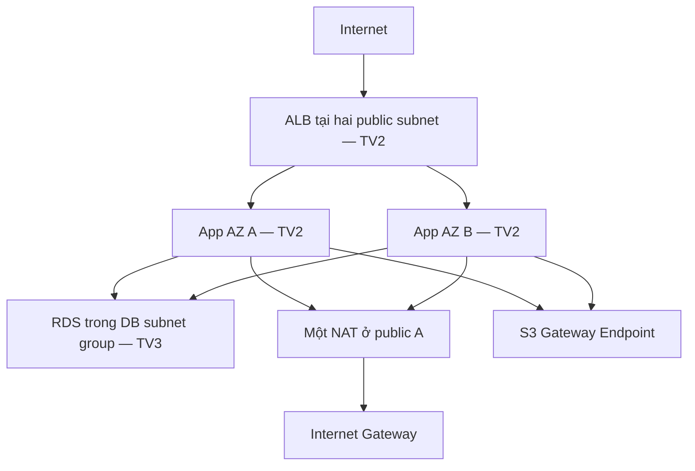

# Thiết kế mạng TV1

Mục tiêu: tách ALB public, app private và DB private trên hai AZ; input không đọc file/state TV2–4. Cấu hình này tạo mạng riêng, không sửa VPC mặc định.

## Subnet mặc định

| Key | AZ mẫu | CIDR | Đường đi |
|---|---|---|---|
| public_a | us-east-1a | 10.20.0.0/24 | 0.0.0.0/0 → IGW |
| public_b | us-east-1b | 10.20.1.0/24 | 0.0.0.0/0 → IGW |
| app_a | us-east-1a | 10.20.10.0/24 | 0.0.0.0/0 → NAT public_a; S3 prefix → endpoint |
| app_b | us-east-1b | 10.20.11.0/24 | 0.0.0.0/0 → NAT public_a; S3 prefix → endpoint |
| db_a | us-east-1a | 10.20.20.0/24 | Chỉ local trong VPC |
| db_b | us-east-1b | 10.20.21.0/24 | Chỉ local trong VPC |

VPC `10.20.0.0/16`. CIDR từng subnet tính từ VPC bằng `cidrsubnet`; kiểm trùng với VPC/peering/VPN trước khi dùng. Mọi subnet tắt tự gán public IP; ALB internet-facing và NAT do dịch vụ quản lý địa chỉ public. TV2 phải đặt `associate_public_ip_address=false`; TV3 phải đặt RDS `publicly_accessible=false` vì subnet setting không tự bảo đảm mọi tài nguyên private.

## Sơ đồ

ALB/app/DB trong hình là các thành phần dự kiến tích hợp, chưa được tạo bởi gói này.

## Security Groups

| SG | Inbound | Outbound |
|---|---|---|
| alb | TCP 80 từ Internet | TCP 8000 tới SG app |
| app | TCP 8000 chỉ từ SG alb | TCP 5432 tới SG db; TCP 80/443 ra ngoài |
| db | TCP 5432 chỉ từ SG app | Không khai báo outbound mới; traffic trả lời được SG stateful cho phép |

Không mở port 22. TV2 quản trị bằng SSM cùng profile TV3. App egress 80/443 để cập nhật OS và gọi SSM/CloudWatch/Parameter Store; chưa phải lọc domain. Amazon-provided DNS không bị SG chặn. Default NACL được giữ nguyên; kiểm soát bằng route và SG. S3 endpoint chỉ gắn route table app; policy endpoint mặc định không thay thế IAM/bucket policy tối thiểu do TV3 sở hữu. TLS vào ALB chưa cấu hình: demo HTTP chỉ dữ liệu giả; HTTPS cần nhóm có domain/ACM và thay đổi được review.

## Inputs và outputs

Inputs: project=labseat, environment=lab, region=us-east-1, vpc_cidr=10.20.0.0/16, availability_zones=[us-east-1a,us-east-1b]. AZ là cấu hình mẫu phải kiểm quyền/khả dụng trong tài khoản thật. Module kế thừa provider từ root; provider region phải trùng input region.

| Output | Người dùng |
|---|---|
| vpc_id | TV2 |
| public_subnet_ids | TV2 ALB |
| app_subnet_ids | TV2 ASG |
| db_subnet_ids | TV3 RDS |
| alb_sg_id, app_sg_id | TV2 |
| db_sg_id | TV3 |
| s3_endpoint_id | TV1 evidence và audit |

Danh sách subnet luôn thứ tự AZ A rồi B; không phụ thuộc sắp xếp ID. Handoff chỉ chứa tên output cho đến khi apply thật.

## Giới hạn và kiểm chứng

Một NAT ở AZ A là điểm lỗi và app AZ B có thể phát sinh phí xuyên AZ. Hai AZ không đồng nghĩa hệ thống chịu lỗi toàn AZ; RDS Single-AZ do TV3 dựng cũng có giới hạn. Kiểm mock chỉ kiểm cấu hình, không kiểm routing/SSM/Internet thực tế.

Sau apply: xem Resource map, 6 associations, route DB không default/S3, NAT Available và EIP, app không public IP, SG source đúng. Sau tích hợp: ALB Healthy, app truy cập DB/S3/SSM, thử truy cập trực tiếp từ Internet phải không được. Ghi kết quả và ảnh thực vào hồ sơ; chưa có app không nhận E2E đạt.

Kiểm tra nguồn bổ sung (tùy chọn, cần Python và python-hcl2): `python docs/tv1/check-source.py`. Script này không thay thế terraform validate/test.
